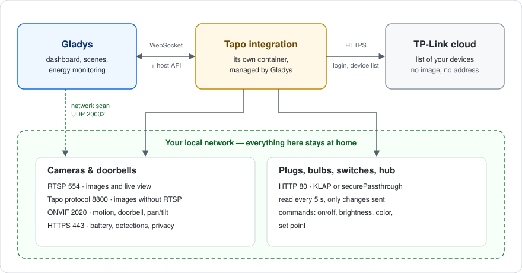
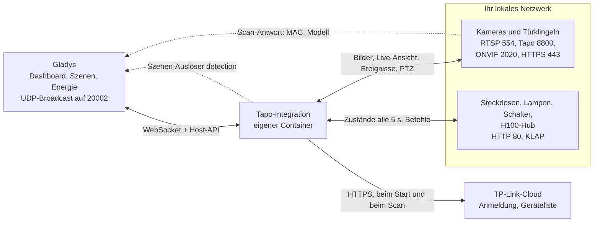
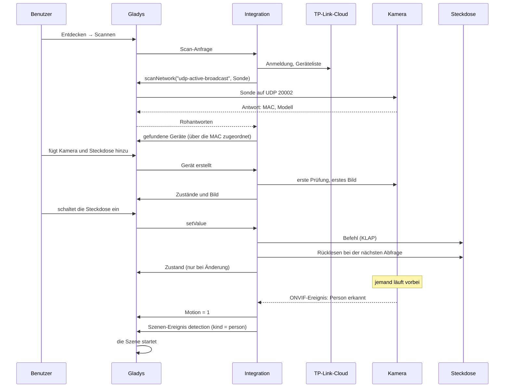
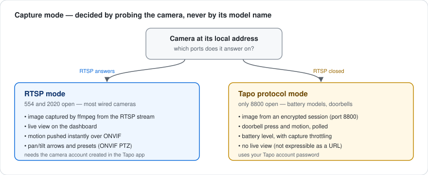
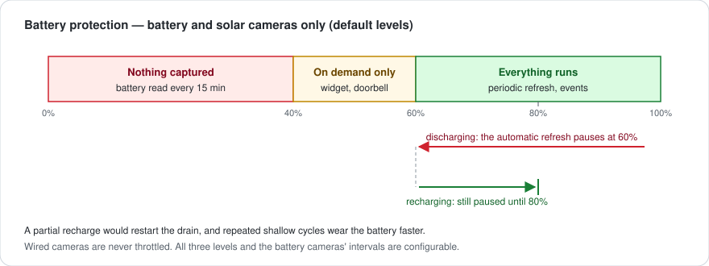
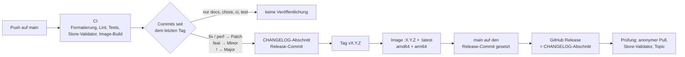

[English](README.md) · [Français](README.fr.md) · **Deutsch** · [Español](README.es.md)

# gladys-tapo

[](LICENSE)
[](https://github.com/William-De71/gladys-tapo/releases)
[](https://github.com/William-De71/gladys-tapo/actions/workflows/release.yml)
[](https://gladysassistant.com)


Externe [Gladys Assistant](https://gladysassistant.com)-Integration für **TP-Link Tapo**-Geräte: Kameras und Türklingeln, Steckdosen und Steckdosenleisten, Lampen und LED-Streifen, Wandschalter sowie die Sensoren des H100-Hubs. Mit einem Klick aus dem Store installiert, fragt sie die TP-Link-Cloud nur nach einem — der Liste Ihrer Geräte — und erledigt alles Weitere **in Ihrem lokalen Netzwerk**: Bilder, Live-Ansicht, Bewegung, Klingeln, Schwenken/Neigen, Befehle und Zustände. Die Geräte werden durch einen Netzwerkscan gefunden, ihre Funktionen folgen dem, was jedes Gerät antwortet, und eine Kamera, die eine Person, ein Fahrzeug oder ein Haustier sieht, kann eine Szene starten.

📖 Benutzerdokumentation: [English](docs/en.md) — [Français](docs/fr.md) — [Deutsch](docs/de.md) — [Español](docs/es.md)

> **Voraussetzung:** Bei manchen Firmwares muss die **Drittanbieter-Kompatibilität** in der Tapo-App aktiviert sein (_Ich_ → _Drittanbieterdienste_, oder _Ich_ → _Tapo Lab_ bei älteren App-Versionen). Ohne sie verweigert eine Kamera RTSP und ONVIF, und eine neuere Steckdose oder Lampe kann Ihr Tapo-Konto ablehnen. Das ist das Erste, was zu prüfen ist, wenn ein Gerät „nicht antwortet“.

## Funktionen

- **Alle Tapo-Familien**: Kameras und Türklingeln, Steckdosen und Steckdosenleisten, Lampen und LED-Streifen, Wandschalter, Sensoren des H100-Hubs (Temperatur, Luftfeuchtigkeit, Bewegung, Öffnung, Wasserleck, Taster, Heizkörperthermostat).
- **Automatische Erkennung**: Die Cloud listet Ihre Geräte, ein Netzwerkscan findet jedes an seiner MAC-Adresse; eine Adresse wird nur für ein Gerät in einem anderen Subnetz eingegeben.
- **Zwei Aufnahmemodi**: RTSP mit dem Kamerakonto (Live-Ansicht inbegriffen) oder das proprietäre Tapo-Protokoll für die Akkumodelle und Türklingeln ohne RTSP.
- **Sofortige Ereignisse**: Bewegung und Klingeln werden per ONVIF gepusht, wenn die Kamera es anbietet, sonst abgefragt; ein Klingeln sendet sofort ein frisches Bild.
- **Szenen**: Der Auslöser **Erkennung einer Tapo-Kamera** startet eine Szene bei einer Person, einem Fahrzeug, einem Haustier, einer Bewegung oder einem Klingeln, Kamera für Kamera.
- **Schwenken/Neigen und Positionen**: Pfeile im Kamera-Widget und die in der Tapo-App gespeicherten Positionen, in Szenen nutzbar.
- **Privatmodus**: das Standard-Steuerelement **Aktiviert** der Gladys-Kameras, das bei Modellen mit Privatsphäre-Modus auch das Objektiv abdeckt.
- **Schont die Akkus**: Akku- und Solarkameras haben eigene Intervalle und hören auf aufzunehmen, wenn ihr Stand sinkt.
- **Vier Sprachen**: Englisch, Französisch, Deutsch und Spanisch, in Gladys und in der Dokumentation.

## Funktionsweise





Vom Scan zu einem Befehl, einem Zustand, einer Erkennung und einer Szene:



| Kanal                                  | Wofür                                                                            |
| -------------------------------------- | -------------------------------------------------------------------------------- |
| **TP-Link-Cloud** (HTTPS)              | die Anmeldung an Ihrem Konto und die Liste Ihrer Geräte — sonst nichts           |
| **Netzwerkscan** (UDP 20002)           | jedes Gerät finden, über seine MAC-Adresse zugeordnet; Broadcast durch Gladys    |
| **Kameras** (RTSP, 8800, ONVIF, 443)   | Bilder, Live-Ansicht, Bewegung, Klingel, Schwenken/Neigen, Akku, Privatmodus     |
| **Steckdosen, Lampen, Hubs** (HTTP 80) | Zustände und Befehle, alle paar Sekunden gelesen, nur Änderungen gehen an Gladys |

### Erkennung: Zuordnung über die MAC-Adresse


Die Sonde ist ein wohlgeformtes TDP-Paket (16-Byte-Header mit Nutzlastgröße, Flags und CRC32, dann ein JSON-Körper mit einem öffentlichen RSA-Schlüssel), vom Gladys-Kern als Broadcast weitergeleitet (`network_discovery` im Manifest). Eine Antwort nennt eine **gehashte** 32-stellige `device_id`, nicht die 40-stellige Kennung aus der Cloud-Liste: Die Antworten werden daher über die **MAC-Adresse** zugeordnet, die einzige Kennung, die beide Seiten im Klartext angeben. Der Kern erlaubt einen Scan alle 10 Sekunden: Die Ergebnisse werden eine Minute zwischengespeichert, und ein Gerät behält seine letzte bekannte Adresse, wenn ein Scan fehlschlägt.

### Kameras: Aufnahmemodi



Der Modus wird durch Abfragen der Kamera bestimmt, nie anhand ihres Modellnamens: Eine Kamera ohne RTSP ist keine Kamera ohne lokalen Zugang. Akkumodelle und Türklingeln (C610, C425, D230…) schließen die Ports 554 und 2020, liefern ihr Video aber über das proprietäre Protokoll auf Port 8800 — durchgehend an einer C610 überprüft.

Live-Video gibt es nur für RTSP-Kameras: Es läuft über den Parameter `CAMERA_URL`, der dem Dienst rtsp-camera übergeben wird, und eine verschlüsselte 8800-Sitzung lässt sich nicht als URL ausdrücken. Den 8800-Stream über einen HTTP-Server in der Integration weiterzuleiten, funktioniert ebenfalls nicht: Das Netzwerk `gladys-integrations` wird mit `com.docker.network.bridge.enable_icc=false` erstellt, sodass sich nichts IN einen Integrations-Container verbinden kann — nicht einmal Gladys, wo ffmpeg läuft. Ein Bild, das größer ist, als der Host annimmt, wird lokal aus der ersten Aufnahme neu kodiert statt erneut aufgenommen: Eine Akkukamera wird pro Bild nur einmal geweckt.

### Kameras: Ereignisse


| Weg                        | Funktionsweise                                                                 | Latenz               |
| -------------------------- | ------------------------------------------------------------------------------ | -------------------- |
| **ONVIF** (TCP 2020)       | `PullMessages` wird von der Kamera offen gehalten, sie antwortet bei Erkennung | nahezu sofort        |
| **Lokale Erkennungsliste** | `searchDetectionList` wird alle `event_poll_interval` abgefragt                | bis zu einer Abfrage |

ONVIF macht eine Bewegung als Szenen-Auslöser nutzbar, und es ist der einzige Weg, der die **fallende** Flanke meldet. Es braucht das Kamerakonto: Eine Kamera ohne Konto bleibt beim Abfrageweg; Akkukameras bleiben ohnehin dabei, denn ein rund um die Uhr offener Pull Point hielte ihr Funkmodul wach. Die beiden Wege laufen nie gleichzeitig auf derselben Kamera — sonst würde jede Bewegung ihre Szene zweimal auslösen. Abonnements werden vor ihrem Ablauf erneuert und beim Verwerfen freigegeben: Die Firmware hält nur wenige.

## Unterstützte Geräte


Die Fähigkeiten werden **bei jedem Gerät abgefragt**, nie aus dem Modell abgeleitet: Eine Lampe erhält eine Farbsteuerung, weil ihre Antwort einen Farbton enthält, eine Steckdose einen Energiezähler, weil sie auf `get_energy_usage` geantwortet hat, eine Kamera Schwenk-/Neigepfeile, weil ihr ONVIF-Profil sie deklariert.

| Kamerafunktion (Name in Gladys) | Kategorie / Typ        | Erstellt, wenn                                                       |
| ------------------------------- | ---------------------- | -------------------------------------------------------------------- |
| _der Kameraname_ (Bild)         | `camera/image`         | immer                                                                |
| Enabled                         | `camera/enabled`       | immer (Privatmodus)                                                  |
| Motion                          | `motion-sensor/binary` | die Kamera meldet Ereignisse                                         |
| Doorbell                        | `button/push`          | die Kamera meldet Ereignisse, außer sie sagt, sie habe keine Klingel |
| Capture                         | `button/push`          | Akkukameras (Bild auf Abruf)                                         |
| Move                            | `camera/move`          | das ONVIF-Profil deklariert Schwenken/Neigen                         |
| Preset                          | `camera/preset`        | die Kamera hat in der Tapo-App gespeicherte Positionen               |
| Battery                         | `battery/integer` (%)  | Akku- und Solarmodelle                                               |

| Gerät                  | Beispiele                          | In Gladys                                            |
| ---------------------- | ---------------------------------- | ---------------------------------------------------- |
| Steckdose              | P100, P105, P115                   | Ein/Aus                                              |
| Steckdose mit Messung  | P110, P110M, P115                  | Ein/Aus, Leistung (W), Energie (kWh)                 |
| Steckdosenleiste       | P300, P304M, P306                  | Ein Gerät pro Steckplatz, jeder einzeln geschaltet   |
| Lampe, LED-Streifen    | L510, L530, L630, L900, L920, L930 | Ein/Aus, Helligkeit, Farbe und Weiß (je nach Modell) |
| Wandschalter           | S500, S505 / S500D, S505D          | Ein/Aus / Dimmer (Helligkeit)                        |
| Sensoren des H100-Hubs | T310, T315                         | Temperatur, Luftfeuchtigkeit                         |
|                        | T100                               | Bewegung                                             |
|                        | T110                               | Öffnung (Tür, Fenster)                               |
|                        | T300                               | Wasserleck                                           |
|                        | S200B, S200D                       | Taster: Einfachklick, Doppelklick                    |
|                        | KE100                              | Temperatur und Sollwert des Heizkörperthermostats    |

Jeder Hub-Sensor wird zu einem eigenen Gerät, mit einem Alarm bei schwacher Batterie (und dem Batteriestand, wenn der Sensor ihn meldet). Die Funktionsnamen legt die Integration auf Englisch fest (`Garage - Motion`), unabhängig von der Sprache von Gladys; jeder kann umbenannt werden. Noch nicht unterstützt: der Hub **H200** (er spricht das Protokoll der Kameras), die älteren **Kasa**-Geräte (IOT-Protokoll), Saugroboter und die Hub-Schalter **S210 / S220** — sie werden in **Verbindung testen** und in den Protokollen genannt, statt stillschweigend ignoriert zu werden.

## Konfiguration

| Feld                                                         | Standard     | Verwendung                                                                            |
| ------------------------------------------------------------ | ------------ | ------------------------------------------------------------------------------------- |
| E-Mail / Passwort des Tapo-Kontos                            | leer         | das Konto der Tapo-App; die Zwei-Faktor-Authentifizierung verhindert diese Anmeldung  |
| Cloud-Region                                                 | Europa       | die nächstgelegene TP-Link-Cloud (Europa, Amerika, Asien, Weltweit)                   |
| Benutzername / Passwort des Standardkontos                   | leer         | das in der Tapo-App erstellte Kamerakonto, wenn es auf allen Kameras gleich ist       |
| Konten pro Kamera (erweitert)                                | leer         | `name\|benutzername\|passwort`, durch Kommas getrennt; die Aktion unten ist einfacher |
| Bildqualität                                                 | HD           | HD ist schärfer, SD leichter und schneller aufzunehmen                                |
| Manuelle Adressen (erweitert)                                | leer         | `name\|ip` (oder `name=ip`), durch Kommas getrennt; die Aktion unten ist sicherer     |
| Prüfintervall für Ereignisse (s)                             | 20           | wie oft eine Kamera ohne ONVIF nach ihren Erkennungen gefragt wird (5 bis 300)        |
| Leseintervall für Steckdosen, Lampen und Sensoren (Sekunden) | 5            | wie oft Steckdosen, Lampen, Schalter und Hubs gelesen werden (2 bis 300)              |
| Aufnahme-Zeitlimit (s)                                       | 14           | wie viel Zeit eine Kamera bekommt, um ein Bild zu liefern (5 bis 60)                  |
| Bildaktualisierungsintervall (s)                             | 60           | regelmäßige Aufnahme der netzbetriebenen Kameras (15 bis 3600)                        |
| Aktualisierungs- / Prüfintervall für Akkukameras (s)         | 900 / 300    | dieselben beiden Intervalle für Akku- und Solarkameras                                |
| Aufnahme pausieren / stoppen / fortsetzen (%)                | 60 / 40 / 80 | die Akkustände des [Akkuschutzes](#akkukameras)                                       |

| Aktion                            | Was sie tut                                                                                                    |
| --------------------------------- | -------------------------------------------------------------------------------------------------------------- |
| Verbindung testen                 | meldet sich an, scannt und zeigt eine Zeile pro Gerät: seine Adresse, ihre Herkunft, seinen Aufnahmemodus      |
| IP-Adresse eines Geräts festlegen | speichert die Adresse eines Geräts (aus der Liste gewählt), prüft, ob es antwortet, und nimmt ein Testbild auf |
| Kamerakonto speichern             | speichert das Kamerakonto einer Kamera und versucht damit sofort eine Aufnahme                                 |
| Bilder aktualisieren              | nimmt sofort ein neues Bild jeder Kamera auf                                                                   |

Die von den Aktionen gespeicherten Adressen und Kamerakonten hängen an der **Cloud-Kennung** des Geräts: Ein Umbenennen, in Gladys oder in der Tapo-App, behält sie bei. Führen Sie **IP-Adresse eines Geräts festlegen** mit leerer Adresse aus, um zum Scan zurückzukehren.

## Transport

Das Manifest deklariert `"transports": ["local", "cloud"]`, doch die Cloud dient nur dazu, Ihre Geräte zu **listen**: die Anmeldung an Ihrem Konto und die Geräteliste, beim Start und bei jedem Scan. Bilder, Live-Ansicht, Ereignisse, Befehle und Zustände laufen alle über Ihr lokales Netzwerk — TP-Link bietet Dritten ohnehin keine Möglichkeit, ein Bild über die Cloud zu erhalten, und die Tapo-App erreicht ihre Kameras aus der Ferne über Relays, die ihr selbst vorbehalten sind.

Steckdosen, Lampen, Schalter und Hubs tragen ein **Transport-Abzeichen**: **Lokal**, solange das Gerät auf seine Abfrage antwortet, sonst **Nicht erreichbar**. Sie werden in jedem **Leseintervall für Steckdosen, Lampen und Sensoren** gelesen — eine Anfrage pro physischem Gerät, ein Hub mit zehn Sensoren kostet eine einzige — und nur die geänderten Werte gehen an Gladys. Ein in Gladys erstelltes Gerät wird sofort gelesen: Sein Zustand und, bei einer Kamera, sein erstes Bild erscheinen, ohne auf die nächste Runde zu warten.

Mit Steckdosen, Lampen und Hubs werden zwei lokale Protokolle gesprochen, aus der Scan-Antwort gewählt oder durch Ausprobieren ermittelt: **KLAP** (zwei Handshakes, dann AES-128-CBC mit einer Sequenznummer im IV und einer SHA-256-Signatur; beide Hash-Generationen) und das ältere **securePassthrough** (RSA-Handshake, dann `login_device`). Anfragen an ein Gerät laufen nacheinander; mehrere Methoden gehen als ein `multipleRequest`; Steckplätze einer Leiste und Hub-Sensoren werden per `control_child` erreicht. Steckdosen mit Messung melden nur die Energie des Tages, um Mitternacht zurückgesetzt: Sie wird zu einem kumulierten kWh-Zählerstand aufsummiert, der Form, die die Energieüberwachung von Gladys liest.

## Szenen

| Auslöser                    | Wann                                                                                                                    | Filter          | Variablen                |
| --------------------------- | ----------------------------------------------------------------------------------------------------------------------- | --------------- | ------------------------ |
| Erkennung einer Tapo-Kamera | Eine Kamera oder Türklingel hat eine Person, ein Fahrzeug, ein Haustier, eine Bewegung gesehen oder es wurde geklingelt | Kamera, Erkannt | `camera`, `name`, `kind` |

| Erkannt  | `kind`     | Gemeldet, wenn                                                                                |
| -------- | ---------- | --------------------------------------------------------------------------------------------- |
| Person   | `person`   | die Kamera intelligente Erkennung hat, in der Tapo-App aktiviert, und eine Person erkannt hat |
| Fahrzeug | `vehicle`  | ebenso, für ein Fahrzeug                                                                      |
| Haustier | `pet`      | ebenso, für ein Haustier                                                                      |
| Bewegung | `motion`   | jede andere Bewegung — jede Bewegung bei einer Kamera ohne intelligente Erkennung             |
| Klingeln | `doorbell` | jemand hat geklingelt                                                                         |

Die Kamera sagt, was sie gesehen hat, über ihre ONVIF-Topics (`PeopleDetector`, `VehicleDetect`, `PetDetect`…) oder die Bezeichnungen ihrer Erkennungsliste; die Integration rät nie. Jede Kamera und Art löst **höchstens einmal pro Minute** aus: Eine Kamera wiederholt ihren Zustand, solange die Bewegung dauert, und die Szene läuft einmal pro Erkennung, nicht pro Meldung. Die einfache Bewegung, die eine Person, ein Fahrzeug oder ein Haustier begleitet, löst nichts weiter aus. Lassen Sie **Kamera** leer, um alle Kameras zu überwachen, **Erkannt** leer für alle Arten. Nur die zu Gladys hinzugefügten Kameras lösen aus. Die Funktionen **Motion** und **Doorbell** bleiben mit dem Standard-Auslöser **Änderung von Gerätestatus** nutzbar.

Drei Szenen für den Anfang:

- **Den Garten beleuchten, wenn nachts jemand da ist**: Auslöser **Erkennung einer Tapo-Kamera** mit Kamera `Garten`, Erkannt **Person**; Bedingung **Zeitbedingung** nach 22:00 und vor 06:00; Aktion **Licht einschalten** für die Gartenlampen, dann **Warten** 5 Minuten und **Licht ausschalten**. Eine Katze, die über den Rasen läuft, schaltet nichts ein.
- **Ein Klingeln auf Ihrem Handy, mit Bild**: Auslöser **Erkennung einer Tapo-Kamera** mit Erkannt **Klingeln**; Aktion **Kameraaufnahme senden** mit der Türklingel. Die Integration nimmt das Bild auf, sobald die Taste gedrückt wird: Es zeigt den Besucher. Fügen Sie **Nachricht senden** „Es hat an _Name der Kamera_ geklingelt“ mit der Variable **Name der Kamera** hinzu, wenn Sie mehrere Türklingeln haben.
- **Haustiere ignorieren**: eine Szene auf **Person** und eine weitere auf **Fahrzeug**, statt einer einzigen auf alle Arten. Bei einer Kamera ohne intelligente Erkennung kommt alles als **Bewegung** an: Aktivieren Sie zuerst die intelligente Erkennung in der Tapo-App.

## Akkukameras



Die Aufnahme ist es, die eine Akkukamera leert: Akkumodelle werden daher gedrosselt. Standardmäßig stoppt die regelmäßige Aufnahme unter 60 %, unter 40 % wird gar nichts mehr aufgenommen, und die Aufnahme wird bei 80 % fortgesetzt — deutlich über der Pausenschwelle, denn eine Teilladung würde die Entladung sofort neu starten, und flache Zyklen verschleißen den Akku. Eine Akkukamera, die nicht mehr antwortet, wird ebenfalls auf Aufnahmen auf Abruf beschränkt: Ihr letzter Stand ist nicht mehr verlässlich. Akkukameras haben ein eigenes Aufnahmeintervall (15 Minuten) und Prüfintervall (5 Minuten): Die Kamera zu wecken, kostet weit mehr als das Bild selbst. Sie haben weder Live-Ansicht noch ONVIF: Ihre Erkennungen, und der Erkennungs-Auslöser, kommen bei der nächsten Prüfung an. Türklingeln werden nie gedrosselt — ein Klingeln muss in Sekunden ankommen. Alle Stände und Intervalle sind einstellbar.

## Installation

1. In Gladys (**5.3.0 oder neuer**): **Integrationen → Store**, nach **Tapo** suchen, installieren.
2. Im Bildschirm **Konfiguration** Ihr Tapo-Konto (E-Mail, Passwort) und die Region eingeben, dann auf **Verbindung testen** klicken.
3. **Entdecken → Scannen**, dann Ihre Geräte hinzufügen.
4. Für die kabelgebundenen Kameras (RTSP) **Kamerakonto speichern** mit dem in der Tapo-App erstellten Kamerakonto ausführen (Kameraeinstellungen → Erweiterte Einstellungen → Kamerakonto): Es schaltet RTSP, die Live-Ansicht, Bewegung über ONVIF und Schwenken/Neigen frei.

Die Integration setzt Gladys 5.3.0 voraus (Szenen-Auslöser seit 5.1.0, Katalog-Schlüsselwörter von Gladys 5.3): Ein älteres Gladys erhält ihre Updates nicht mehr und bleibt auf der letzten Version, die es akzeptierte (2.0.0 unter 5.0, 2.1.2 unter 5.1 und 5.2), bis Gladys selbst aktualisiert wird. Von 1.x kommend: Der **Privatsphäre-Schalter** der Kameras wird durch das Steuerelement **Aktiviert** (`camera/enabled`) ersetzt, sobald die Kamera im Bildschirm Entdecken aktualisiert wird — passen Sie die Szenen an, die ihn nutzten, seine Werte sind umgekehrt (1 bedeutet jetzt „Kamera aktiv“). Der Scan sieht kein Gerät in einem anderen Subnetz oder VLAN: Führen Sie **IP-Adresse eines Geräts festlegen** mit der in der Tapo-App angezeigten Adresse aus (Geräteeinstellungen → Geräteinformationen), und reservieren Sie diese Adresse in Ihrem Router. Die [Benutzerdokumentation](docs/de.md) erläutert die Einrichtung, die Adressen, die Akkukameras, den Privatmodus, Schwenken/Neigen und die Szenen.

## Entwicklung

```bash
npm install
GLADYS_HOST_API_URL="http://localhost:1443" \
GLADYS_INTEGRATION_TOKEN="<token>" \
npm start
```

`ffmpeg` muss verfügbar sein, um Bilder aufzunehmen; das Docker-Image installiert es.

```
index.js                    nur die SDK-Verdrahtung: createApp(gladys), Beenden, Verbinden
src/
  app.js                    alle Handler (Erkennung, Befehle, Bilder, Aktionen, Gerät erstellt)
  sceneEvents.js            Szenen-Auslöser detection (ein Ereignis pro Kamera und Art pro Minute)
  config.js                 Standardwerte, Normalisierung, Freitext, Speicher der Aktionen
  devices.js                Kameras -> Gladys-Geräte, Adressauflösung
  report.js                 Verbindungsbericht pro Gerät und Statusmeldungen
  tapo/                     Kameras und Türklingeln
    constants.js            Protokollwerte, Zeiten, Geräteparameter
    cloud.js                Client der TP-Link-Cloud (Anmeldung, Geräteliste)
    discovery.js            TDP-Netzwerkscan (UDP 20002), MAC-Zuordnung, Scan-Cache
    rtsp.js                 RTSP-URL + Erkennung des Aufnahmemodus (Port-Abfrage)
    snapshot.js             ffmpeg-Aufnahme, beide Modi, größenbegrenzt
    localApi.js             lokale Kamera-API (HTTPS 443): Akku, Erkennungen, Privatsphäre
    onvif.js                ONVIF-Ereignisse per Pull Point (Port 2020), Erkennungsarten
    ptz.js                  ONVIF-PTZ (Schwenk-/Neige-/Zoomschritte, Positionen)
    events.js               Überwachung von Klingel / Bewegung / Akku / Privatsphäre
    batteryGuard.js         Drosselung von Aufnahmen und Abfragen der Akkukameras
    stream/
      aesHelper.js          AES-128-CBC-Schlüsselableitung
      mediaSession.js       proprietäres Stream-Protokoll (Port 8800)
  smart/                    Steckdosen, Leisten, Lampen, Schalter, Hub-Sensoren
    http.js                 minimaler HTTP-Client (Port 80) mit Frist und Cookies
    klap.js                 KLAP-Transport (Handshakes, Sitzungsverschlüsselung)
    aes.js                  securePassthrough-Transport (RSA-Handshake, Anmeldung)
    client.js               Transportwahl, Stapel, Kindgeräte, Backoff
    model.js                Geräteantworten -> Gladys-Geräte, Funktionen und Zustände
    manager.js              Abfrage, nur Änderungen veröffentlichen, Abzeichen, Befehle
```

Die Plattform-Kennung ist die **Cloud-Kennung** des Geräts, die einzige Identität, die ein Umbenennen oder eine neue DHCP-Zuweisung übersteht; die Adresse liegt in einem Geräteparameter. Hub-Sensoren und Steckplätze einer Leiste verwenden die Kennung des Kindgeräts:

```
device : ext:<selector>:<camera|plug|light|switch|sensor>:<id>
feature: ext:<selector>:<camera|plug|light|switch|sensor>:<id>:<feature>
```

Die beim Bau dieser Integration auf Gladys-Seite gefundenen Fehler (dynamisches `select` abgelehnt, `secret`-Feld eines Aktionsformulars, 100-KB-Grenze für Kamerabilder) sind in [BUGS-GLADYS.md](BUGS-GLADYS.md) beschrieben.

## Tests

```bash
npm test               # node --test: falsche Kameras und falsche KLAP/AES-Geräte auf localhost
npm run lint           # ESLint
npm run format:check   # Prettier, wie die CI es ausführt
npx github:GladysAssistant/integration-store . --skip-image-check
```

`test/structure.test.js` vergleicht die Erkennung mit `test/fixtures/discovery.baseline.json`, erzeugt aus v2.0.0 mit vier Kameras (PTZ mit Positionen, Akku, Türklingel, nicht abgefragt), einer Steckdose mit Messung, einer Steckdosenleiste, einer Farblampe, einem Dimmer, einem Wandschalter und einem H100-Hub mit seinen sechs Sensorarten, und das Manifest mit `test/fixtures/manifest.baseline.json`: Eine externe Kennung, eine Kategorie, ein Typ, eine Einheit, eine Grenze oder ein Konfigurationsschlüssel, der sich ändert, würde die Benutzer zwingen, ihre Geräte neu zu erstellen. `test/app.test.js` steuert die Handler mit dem falschen Gladys des SDK, `test/sceneEvents.test.js` den Erkennungs-Auslöser, und `test/i18n.test.js` prüft die Dokumentation und diese READMEs in den vier Sprachen.

## Veröffentlichung

Veröffentlichungen erfolgen automatisch. Jeder Push auf `main` startet die CI und berechnet dann die nächste Version aus den Conventional Commits seit dem letzten Tag:



Das Manifest erreicht `main` erst, wenn sein Image existiert, sodass der Store nie eine Version ankündigt, die er nicht herunterladen kann. `CHANGELOG.md` wird erzeugt: Bearbeiten Sie die Datei nie von Hand. **Actions → Release → Run workflow** bietet `release-as` (eine Version erzwingen) und `dry-run` (Version und Notizen anzeigen, ohne zu veröffentlichen).

Titel von Commits und Pull Requests folgen [Conventional Commits](https://www.conventionalcommits.org/), auf Englisch, formuliert als die Changelog-Zeile, die der Benutzer lesen wird: `feat(scenes): start a scene when a camera sees a person, a vehicle, a pet, a motion or a doorbell press`. `feat` veröffentlicht eine Minor-Version, `fix` und `perf` einen Patch, `!` oder eine Fußzeile `BREAKING CHANGE:` eine Major-Version; `docs`, `chore`, `ci`, `test`, `style`, `refactor` und `build` allein veröffentlichen nichts.

Ist `main` geschützt (Branch-Schutzregel oder Ruleset), kann der Workflow den Branch nur dann auf den Release-Commit setzen, wenn **GitHub Actions** die Regel umgehen darf (Settings → Rules → Bypass list), oder mit dem Token einer GitHub App; andernfalls werden Tag und Image veröffentlicht, aber `main` bleibt zurück.

## Fehlerbehebung

| Symptom                                           | Zu prüfen                                                                                                                                                                                          |
| ------------------------------------------------- | -------------------------------------------------------------------------------------------------------------------------------------------------------------------------------------------------- |
| ✖ _nicht in Ihrem Netzwerk gefunden_              | anderes Subnetz oder VLAN, oder Broadcast gefiltert: **IP-Adresse eines Geräts festlegen** ausführen                                                                                               |
| ⚠ _antwortet nicht_                               | Gerät eingeschaltet, im selben Netzwerk wie Gladys, **Drittanbieter-Kompatibilität** in der Tapo-App aktiviert (_Ich_ → _Drittanbieterdienste_, oder _Ich_ → _Tapo Lab_ bei älteren App-Versionen) |
| Kamerabild, aber keine Live-Ansicht               | die Live-Ansicht braucht RTSP: Akkumodelle und Türklingeln haben keins; bei einer Kabelkamera ihr Kamerakonto speichern                                                                            |
| Bewegung kommt verspätet                          | ohne Kamerakonto wird die Kamera abgefragt: eines speichern, um ONVIF-Push zu erhalten                                                                                                             |
| Erkennung kommt immer als **Bewegung** an         | die intelligente Erkennung (Person, Fahrzeug, Haustier) ist in der Tapo-App aus, oder das Modell hat sie nicht                                                                                     |
| Akkukamera aktualisiert sich nicht mehr           | der Akkuschutz hat sie pausiert — sie setzt beim Ladestand für die Wiederaufnahme fort (standardmäßig 80 %)                                                                                        |
| ✖ _lehnt Drittanbieter-Apps ab_                   | Steckdose, Lampe oder Hub mit neuerer Firmware: **Drittanbieter-Kompatibilität** in der Tapo-App aktivieren; bereits aktiv, ausschalten, eine Minute warten, wieder einschalten                    |
| Steckdose, Lampe oder Hub lehnt das Tapo-Konto ab | E-Mail und Passwort wie in der Tapo-App eingegeben prüfen; eine neuere Firmware kann die **Drittanbieter-Kompatibilität** verlangen                                                                |
| Anmeldung abgelehnt                               | die Zwei-Faktor-Authentifizierung des TP-Link-Kontos verhindert die Anmeldung einer Drittanbieter-Anwendung                                                                                        |

Protokolle: der Tab **Überwachung** der Integration; fügen Sie dem Container `DEBUG=gladys-integration-sdk` hinzu, um die Details des SDK zu sehen. Die Benutzerdokumentation enthält einen ausführlicheren Abschnitt zur Fehlerbehebung.

## Mitwirken

Issues und Pull Requests sind willkommen: [Fehlerbericht](https://github.com/William-De71/gladys-tapo/issues/new?template=bug_report.yml) (Versionen von Gladys und der Integration, Modell und Firmware des Geräts, Protokolle) oder [Funktionswunsch](https://github.com/William-De71/gladys-tapo/issues/new?template=feature_request.yml). Rückmeldungen und Fragen gehören auch in den [Forum-Thread](https://community.gladysassistant.com/t/10531). Sicherheitsprobleme: siehe [SECURITY.md](SECURITY.md).

Der proprietäre Kamerastream ist eine Node.js-Portierung der Media-Stream-Implementierung von [pytapo](https://github.com/JurajNyiri/pytapo), derselbe Ansatz wie bei go2rtc. Die Protokolle KLAP und securePassthrough sowie die Erkennungssonde sind nach der Beschreibung umgesetzt, die das Projekt [python-kasa](https://github.com/python-kasa/python-kasa) von ihnen gibt; die Implementierung ist unabhängig. Aufgebaut auf dem [Gladys-Integrations-SDK](https://github.com/GladysAssistant/integration-sdk-js), ausgehend von der [offiziellen Vorlage](https://github.com/GladysAssistant/integration-template-js).

## Lizenz

[Apache-2.0](LICENSE) — siehe auch [NOTICE](NOTICE). Das Docker-Image enthält [FFmpeg](https://ffmpeg.org) aus den Alpine-Linux-Paketen, unter dessen eigenen Lizenzen (LGPL/GPL). TP-Link und Tapo sind Marken von TP-Link Systems Inc.; dieses Projekt ist weder mit TP-Link verbunden noch von TP-Link unterstützt oder gesponsert.
