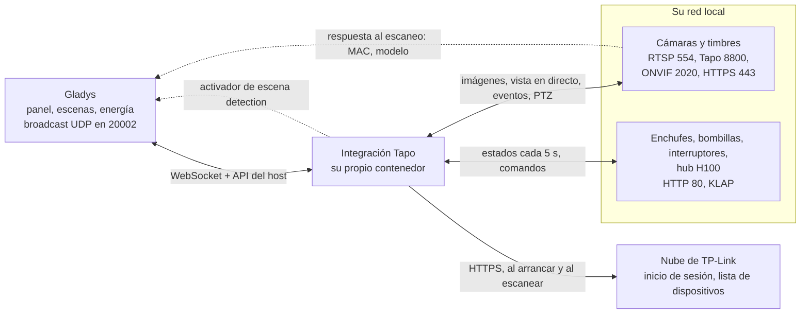
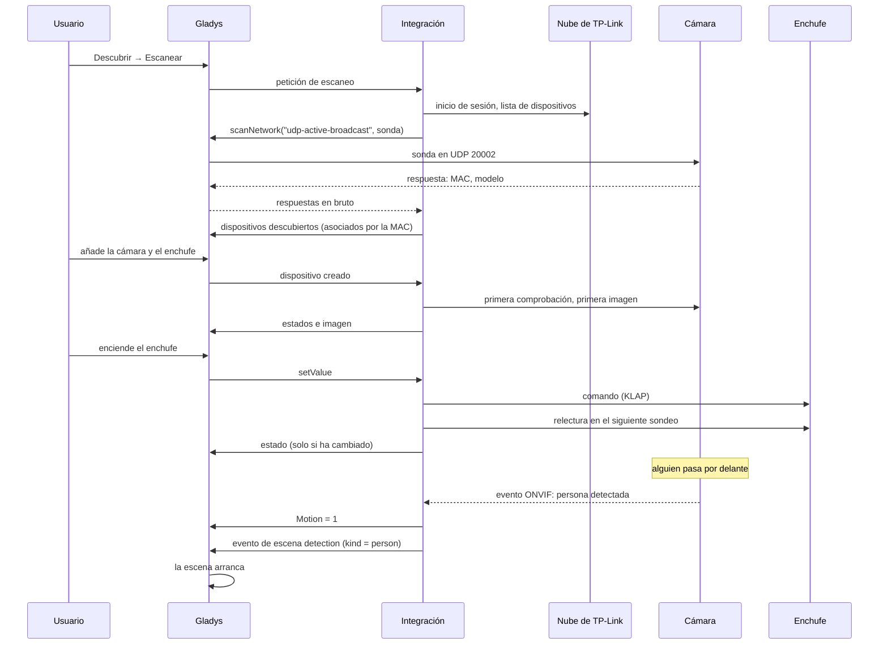
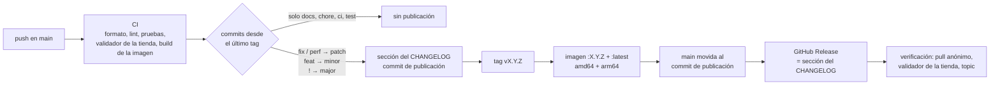

[English](README.md) · [Français](README.fr.md) · [Deutsch](README.de.md) · **Español**

# gladys-tapo

[](LICENSE)
[](https://github.com/William-De71/gladys-tapo/releases)
[](https://github.com/William-De71/gladys-tapo/actions/workflows/release.yml)
[](https://gladysassistant.com)


Integración externa de [Gladys Assistant](https://gladysassistant.com) para los dispositivos **TP-Link Tapo**: cámaras y timbres, enchufes y regletas, bombillas y tiras LED, interruptores de pared y los sensores del hub H100. Instalada desde la tienda en un clic, solo pide una cosa a la nube de TP-Link — la lista de sus dispositivos — y hace todo lo demás **en su red local**: imágenes, vista en directo, movimiento, pulsaciones del timbre, orientación, comandos y estados. Los dispositivos se localizan con un escaneo de la red, sus funcionalidades siguen lo que responde cada dispositivo, y una cámara que ve una persona, un vehículo o una mascota puede lanzar una escena.

📖 Documentación de usuario: [English](docs/en.md) — [Français](docs/fr.md) — [Deutsch](docs/de.md) — [Español](docs/es.md)

> **Requisito previo:** en algunos firmwares, la **Compatibilidad con terceros** debe estar activada en la aplicación Tapo (_Yo_ → _Servicios de terceros_, o _Yo_ → _Tapo Lab_ en versiones antiguas de la aplicación). Sin ella, una cámara rechaza RTSP y ONVIF, y un enchufe o una bombilla reciente puede rechazar su cuenta Tapo. Es lo primero que hay que comprobar cuando un dispositivo «no responde».

## Funciones

- **Todas las familias Tapo**: cámaras y timbres, enchufes y regletas, bombillas y tiras LED, interruptores de pared, sensores del hub H100 (temperatura, humedad, movimiento, apertura, fuga, botones, válvula de radiador).
- **Descubrimiento automático**: la nube lista sus dispositivos, un escaneo de la red encuentra cada uno por su dirección MAC; solo se escribe una dirección para un dispositivo en otra subred.
- **Dos modos de captura**: RTSP con la cuenta de cámara (vista en directo incluida), o el protocolo propietario Tapo para los modelos con batería y los timbres sin RTSP.
- **Eventos inmediatos**: movimiento y pulsaciones del timbre enviados por ONVIF cuando la cámara lo ofrece, sondeados si no; una pulsación del timbre envía de inmediato una imagen nueva.
- **Escenas**: el activador **Detección de una cámara Tapo** lanza una escena ante una persona, un vehículo, una mascota, un movimiento o una pulsación del timbre, cámara por cámara.
- **Orientación y posiciones**: flechas en el widget de cámara y las posiciones guardadas en la aplicación Tapo, utilizables en las escenas.
- **Modo privado**: el control estándar **Activada** de las cámaras de Gladys, que también tapa el objetivo en los modelos con modo privacidad.
- **Cuida las baterías**: las cámaras con batería y solares tienen sus propios intervalos y dejan de capturar cuando baja su nivel.
- **Cuatro idiomas**: inglés, francés, alemán y español, en Gladys y en la documentación.

## Funcionamiento




Del escaneo a un comando, un estado, una detección y una escena:



| Canal                                | Sirve para                                                                              |
| ------------------------------------ | --------------------------------------------------------------------------------------- |
| **Nube de TP-Link** (HTTPS)          | el inicio de sesión en su cuenta y la lista de sus dispositivos — nada más              |
| **Escaneo de la red** (UDP 20002)    | localizar cada dispositivo, asociado por su dirección MAC; broadcast emitido por Gladys |
| **Cámaras** (RTSP, 8800, ONVIF, 443) | imágenes, vista en directo, movimiento, timbre, orientación, batería, modo privado      |
| **Enchufes, luces, hubs** (HTTP 80)  | estados y comandos, leídos cada pocos segundos, solo los cambios van a Gladys           |

### Descubrimiento: asociación por la dirección MAC


La sonda es un paquete TDP bien formado (cabecera de 16 bytes con tamaño, indicadores y CRC32, luego un cuerpo JSON con una clave pública RSA), retransmitido en broadcast por el núcleo de Gladys (`network_discovery` en el manifiesto). Una respuesta anuncia un `device_id` **cifrado con hash** de 32 caracteres, no el identificador de 40 caracteres que lista la nube: las respuestas se asocian, por tanto, por la **dirección MAC**, el único identificador que ambos lados dan en claro. El núcleo permite un escaneo cada 10 segundos: los resultados se guardan en caché un minuto, y un dispositivo conserva su última dirección conocida cuando un escaneo falla.

### Cámaras: modos de captura


El modo se decide sondeando la cámara, nunca por su nombre de modelo: una cámara sin RTSP no es una cámara sin acceso local. Los modelos con batería y los timbres (C610, C425, D230…) cierran los puertos 554 y 2020 pero sirven su vídeo por el protocolo propietario en el puerto 8800 — verificado de extremo a extremo en una C610.

El vídeo en directo solo existe para las cámaras RTSP: pasa por el parámetro `CAMERA_URL` entregado al servicio rtsp-camera, y una sesión 8800 cifrada no puede expresarse como una URL. Retransmitir el flujo 8800 a través de un servidor HTTP dentro de la integración tampoco funciona: la red `gladys-integrations` se crea con `com.docker.network.bridge.enable_icc=false`, así que nada puede conectarse HACIA un contenedor de integración — ni siquiera Gladys, que es donde se ejecuta ffmpeg. Una imagen más pesada de lo que acepta el host se recodifica localmente a partir de la primera captura en lugar de capturarse de nuevo: una cámara con batería solo se despierta una vez por imagen.

### Cámaras: eventos


| Vía                            | Cómo funciona                                                    | Latencia         |
| ------------------------------ | ---------------------------------------------------------------- | ---------------- |
| **ONVIF** (TCP 2020)           | la cámara mantiene abierto `PullMessages` y responde al detectar | casi instantáneo |
| **Lista local de detecciones** | `searchDetectionList` se sondea cada `event_poll_interval`       | hasta un sondeo  |

ONVIF es lo que hace utilizable un movimiento como activador de escena, y es la única vía que indica el flanco **descendente**. Necesita la cuenta de cámara: una cámara sin ella se queda en la vía de sondeo; las cámaras con batería se quedan en ella de todos modos, ya que un pull point abierto día y noche mantendría su radio despierta. Las dos vías nunca funcionan juntas en la misma cámara — si no, cada movimiento lanzaría su escena dos veces. Las suscripciones se renuevan antes de caducar y se liberan al abandonarlas: el firmware solo conserva unas pocas.

## Dispositivos compatibles


Las capacidades se **preguntan a cada dispositivo**, nunca se deducen de su modelo: una bombilla tiene control de color porque su respuesta incluye un tono, un enchufe un contador de energía porque respondió a `get_energy_usage`, una cámara flechas de orientación porque su perfil ONVIF las declara.

| Funcionalidad de cámara (nombre en Gladys) | Categoría / tipo       | Creada cuando                                              |
| ------------------------------------------ | ---------------------- | ---------------------------------------------------------- |
| _el nombre de la cámara_ (imagen)          | `camera/image`         | siempre                                                    |
| Enabled                                    | `camera/enabled`       | siempre (modo privado)                                     |
| Motion                                     | `motion-sensor/binary` | la cámara indica eventos                                   |
| Doorbell                                   | `button/push`          | la cámara indica eventos, salvo si dice no tener timbre    |
| Capture                                    | `button/push`          | cámaras con batería (imagen bajo demanda)                  |
| Move                                       | `camera/move`          | el perfil ONVIF declara la orientación                     |
| Preset                                     | `camera/preset`        | la cámara tiene posiciones guardadas en la aplicación Tapo |
| Battery                                    | `battery/integer` (%)  | modelos con batería y solares                              |

| Dispositivo           | Ejemplos                           | En Gladys                                                   |
| --------------------- | ---------------------------------- | ----------------------------------------------------------- |
| Enchufe               | P100, P105, P115                   | Encendido/apagado                                           |
| Enchufe con medición  | P110, P110M, P115                  | Encendido/apagado, potencia (W), energía (kWh)              |
| Regleta               | P300, P304M, P306                  | Un dispositivo por toma, cada una controlada por separado   |
| Bombilla, tira LED    | L510, L530, L630, L900, L920, L930 | Encendido/apagado, brillo, color y blanco (según el modelo) |
| Interruptor de pared  | S500, S505 / S500D, S505D          | Encendido/apagado / regulador (brillo)                      |
| Sensores del hub H100 | T310, T315                         | Temperatura, humedad                                        |
|                       | T100                               | Movimiento                                                  |
|                       | T110                               | Apertura (puerta, ventana)                                  |
|                       | T300                               | Fuga de agua                                                |
|                       | S200B, S200D                       | Botón: clic simple, doble clic                              |
|                       | KE100                              | Temperatura y consigna de la válvula de radiador            |

Cada sensor del hub se convierte en un dispositivo propio, con una alerta de batería baja (y el nivel de batería cuando el sensor lo indica). Los nombres de las funcionalidades los fija la integración en inglés (`Garage - Motion`), sea cual sea el idioma de Gladys; cada uno puede renombrarse. Todavía no compatibles: el hub **H200** (habla el protocolo de las cámaras), los antiguos dispositivos **Kasa** (protocolo IOT), los robots aspiradores y los interruptores de hub **S210 / S220** — se indican en **Probar la conexión** y en los registros en lugar de ignorarse en silencio.

## Configuración

| Campo                                                         | Por defecto  | Uso                                                                                        |
| ------------------------------------------------------------- | ------------ | ------------------------------------------------------------------------------------------ |
| Correo electrónico / Contraseña de la cuenta Tapo             | vacío        | la cuenta de la aplicación Tapo; la verificación en dos pasos impide este inicio de sesión |
| Región de la nube                                             | Europa       | la nube de TP-Link más cercana (Europa, América, Asia, Mundial)                            |
| Usuario / Contraseña de la cuenta por defecto                 | vacío        | la cuenta de cámara creada en la aplicación Tapo, cuando es la misma en todas las cámaras  |
| Cuentas por cámara (avanzado)                                 | vacío        | `nombre\|usuario\|contraseña`, separadas por comas; la acción de abajo es más sencilla     |
| Calidad de imagen                                             | HD           | HD es más nítida, SD más ligera y rápida de capturar                                       |
| Direcciones manuales (avanzado)                               | vacío        | `nombre\|ip` (o `nombre=ip`), separadas por comas; la acción de abajo es más segura        |
| Intervalo de comprobación de eventos (s)                      | 20           | con qué frecuencia se pregunta a una cámara sin ONVIF por sus detecciones (5 a 300)        |
| Intervalo de lectura de enchufes, luces y sensores (segundos) | 5            | con qué frecuencia se leen enchufes, bombillas, interruptores y hubs (2 a 300)             |
| Tiempo límite de captura (s)                                  | 14           | el tiempo que se concede a una cámara para entregar una imagen (5 a 60)                    |
| Intervalo de actualización de imágenes (s)                    | 60           | captura periódica de las cámaras con alimentación de red (15 a 3600)                       |
| Actualización / comprobación de las cámaras con batería (s)   | 900 / 300    | los mismos dos intervalos para las cámaras con batería y solares                           |
| Pausar / detener / reanudar la captura (%)                    | 60 / 40 / 80 | los niveles de batería de la [protección de la batería](#cámaras-con-batería)              |

| Acción                                    | Qué hace                                                                                                           |
| ----------------------------------------- | ------------------------------------------------------------------------------------------------------------------ |
| Probar la conexión                        | inicia sesión, escanea y muestra una línea por dispositivo: su dirección, su origen, su modo de captura            |
| Definir la dirección IP de un dispositivo | guarda la dirección de un dispositivo (elegido en la lista), comprueba que responde y captura una imagen de prueba |
| Guardar la cuenta de una cámara           | guarda la cuenta de cámara de una cámara e intenta de inmediato una captura con ella                               |
| Actualizar las imágenes                   | captura ahora una nueva imagen de cada cámara                                                                      |

Las direcciones y cuentas de cámara guardadas por las acciones quedan asociadas al **identificador de nube** del dispositivo: cambiarle el nombre, en Gladys o en la aplicación Tapo, las conserva. Ejecute **Definir la dirección IP de un dispositivo** con una dirección vacía para volver al escaneo.

## Transporte

El manifiesto declara `"transports": ["local", "cloud"]`, pero la nube solo sirve para **listar** sus dispositivos: el inicio de sesión en su cuenta y la lista de dispositivos, al arrancar y en cada escaneo. Imágenes, vista en directo, eventos, comandos y estados pasan todos por su red local — de todos modos, TP-Link no ofrece a terceros ninguna forma de obtener una imagen por la nube, y la aplicación Tapo accede a sus cámaras a distancia mediante relés reservados para su propio uso.

Los enchufes, bombillas, interruptores y hubs llevan una **insignia de transporte**: **Local** mientras el dispositivo responde a su sondeo, **Inaccesible** si no. Se leen en cada **Intervalo de lectura de enchufes, luces y sensores** — una petición por dispositivo físico, un hub con diez sensores cuesta una sola — y solo los valores que han cambiado se envían a Gladys. Un dispositivo creado en Gladys se lee de inmediato: su estado y, para una cámara, su primera imagen aparecen sin esperar a la siguiente ronda.

Con los enchufes, luces y hubs se hablan dos protocolos locales, elegidos según la respuesta al escaneo o encontrados probando: **KLAP** (dos negociaciones, luego AES-128-CBC con un número de secuencia en el IV y una firma SHA-256; las dos generaciones de hash) y el antiguo **securePassthrough** (negociación RSA, luego `login_device`). Las peticiones a un dispositivo pasan de una en una; varios métodos salen como un único `multipleRequest`; las tomas de una regleta y los sensores de un hub se alcanzan con `control_child`. Los enchufes con medición solo indican la energía del día, puesta a cero a medianoche: se acumula en un índice kWh, la forma que lee el seguimiento de energía de Gladys.

## Escenas

| Activador                    | Cuándo                                                                                            | Filtros           | Variables                |
| ---------------------------- | ------------------------------------------------------------------------------------------------- | ----------------- | ------------------------ |
| Detección de una cámara Tapo | Una cámara o un timbre ha visto una persona, un vehículo, una mascota, un movimiento, o ha sonado | cámara, detectado | `camera`, `name`, `kind` |

| Detectado            | `kind`     | Indicado cuando                                                                                    |
| -------------------- | ---------- | -------------------------------------------------------------------------------------------------- |
| Persona              | `person`   | la cámara tiene detección inteligente, activada en la aplicación Tapo, y ha reconocido una persona |
| Vehículo             | `vehicle`  | lo mismo, para un vehículo                                                                         |
| Mascota              | `pet`      | lo mismo, para una mascota                                                                         |
| Movimiento           | `motion`   | cualquier otro movimiento — todos los movimientos, en una cámara sin detección inteligente         |
| Pulsación del timbre | `doorbell` | alguien ha llamado al timbre                                                                       |

La cámara dice lo que ha visto mediante sus topics ONVIF (`PeopleDetector`, `VehicleDetect`, `PetDetect`…) o las etiquetas de su lista de detecciones; la integración nunca adivina. Cada cámara y tipo se activa **como máximo una vez por minuto**: una cámara repite su estado mientras dura el movimiento, y la escena se ejecuta una vez por detección, no por notificación. El simple movimiento que acompaña a una persona, un vehículo o una mascota no activa nada más. Deje **Cámara** vacío para vigilar todas las cámaras, **Detectado** vacío para todos los tipos. Solo las cámaras añadidas a Gladys activan el activador. Las funcionalidades **Motion** y **Doorbell** siguen siendo utilizables con el activador estándar **Cambio de estado del dispositivo**.

Tres escenas para empezar:

- **Iluminar el jardín cuando alguien pasa de noche**: activador **Detección de una cámara Tapo** con la cámara `Jardín`, detectado **Persona**; condición **Condición de hora** después de las 22:00 y antes de las 06:00; acción **Encender las luces** del jardín, luego **Esperar** 5 minutos y **Apagar las luces**. Un gato que cruza el césped no enciende nada.
- **Una llamada al timbre en su teléfono, con la foto**: activador **Detección de una cámara Tapo** con detectado **Pulsación del timbre**; acción **Enviar una imagen de cámara** con el timbre. La integración captura la imagen en cuanto se pulsa el botón: muestra al visitante. Añada **Enviar mensaje** «Han llamado a _Nombre de la cámara_» con la variable **Nombre de la cámara** si tiene varios timbres.
- **Ignorar las mascotas**: una escena en **Persona** y otra en **Vehículo**, en lugar de una sola para todos los tipos. En una cámara sin detección inteligente, todo llega como **Movimiento**: active primero la detección inteligente en la aplicación Tapo.

## Cámaras con batería


Es la captura lo que vacía una cámara con batería: por eso los modelos con batería se limitan. Por defecto, la captura periódica se detiene por debajo del 60 %, no se captura nada por debajo del 40 %, y la captura se reanuda al 80 % — muy por encima del umbral de pausa, ya que una recarga parcial reiniciaría la descarga y los ciclos cortos desgastan la batería. Una cámara con batería que deja de responder también se limita a capturas bajo demanda: su último nivel ya no es fiable. Las cámaras con batería tienen su propio intervalo de captura (15 minutos) y de comprobación (5 minutos): despertar la cámara cuesta mucho más que la propia imagen. No tienen ni vista en directo ni ONVIF: sus detecciones, y el activador de detección, llegan en la siguiente comprobación. Los timbres nunca se limitan — una pulsación debe llegar en segundos. Todos los niveles e intervalos son configurables.

## Instalación

1. En Gladys (**5.3.0 o posterior**): **Integraciones → Tienda**, busque **Tapo** e instálela.
2. En su pantalla **Configuración**, introduzca su cuenta Tapo (correo electrónico, contraseña) y la región, y haga clic en **Probar la conexión**.
3. **Descubrir → Escanear**, y añada sus dispositivos.
4. Para las cámaras cableadas (RTSP), ejecute **Guardar la cuenta de una cámara** con la cuenta de cámara creada en la aplicación Tapo (ajustes de la cámara → Ajustes avanzados → Cuenta de la cámara): desbloquea RTSP, la vista en directo, el movimiento por ONVIF y la orientación.

La integración requiere Gladys 5.3.0 (activador de escena desde la 5.1.0, palabras clave del catálogo de Gladys 5.3): un Gladys más antiguo ya no recibe sus actualizaciones y se queda en la última versión que aceptaba (2.0.0 en 5.0, 2.1.2 en 5.1 y 5.2) hasta que se actualice el propio Gladys. Viniendo de la 1.x: el **interruptor de privacidad** de las cámaras se sustituye por el control **Activada** (`camera/enabled`) una vez actualizada la cámara desde la pantalla Descubrir — vuelva a apuntar las escenas que lo usaban, sus valores están invertidos (1 significa ahora «cámara activa»). El escaneo no ve un dispositivo en otra subred o VLAN: ejecute **Definir la dirección IP de un dispositivo** con la dirección mostrada en la aplicación Tapo (ajustes del dispositivo → Información del dispositivo), y reserve esa dirección en su router. La [documentación de usuario](docs/es.md) detalla la instalación, las direcciones, las cámaras con batería, el modo privado, la orientación y las escenas.

## Desarrollo

```bash
npm install
GLADYS_HOST_API_URL="http://localhost:1443" \
GLADYS_INTEGRATION_TOKEN="<token>" \
npm start
```

`ffmpeg` debe estar disponible para capturar imágenes; la imagen Docker lo instala.

```
index.js                    solo la conexión del SDK: createApp(gladys), parada, conexión
src/
  app.js                    todos los handlers (descubrimiento, comandos, imágenes, acciones, dispositivo creado)
  sceneEvents.js            activador de escena detection (un evento por cámara y tipo por minuto)
  config.js                 valores por defecto, normalización, texto libre, almacenes de las acciones
  devices.js                cámaras -> dispositivos Gladys, resolución de direcciones
  report.js                 informe de conexión por dispositivo y mensajes de estado
  tapo/                     cámaras y timbres
    constants.js            valores del protocolo, tiempos, parámetros de dispositivo
    cloud.js                cliente de la nube de TP-Link (inicio de sesión, lista de dispositivos)
    discovery.js            escaneo TDP de la red (UDP 20002), asociación MAC, caché del escaneo
    rtsp.js                 URL RTSP + detección del modo de captura (sondeo de puertos)
    snapshot.js             captura ffmpeg, ambos modos, tamaño acotado
    localApi.js             API local de las cámaras (HTTPS 443): batería, detecciones, privacidad
    onvif.js                eventos ONVIF por pull point (puerto 2020), tipos de detección
    ptz.js                  PTZ ONVIF (pasos de orientación y zoom, posiciones)
    events.js               vigilancia de timbre / movimiento / batería / privacidad
    batteryGuard.js         limitación de capturas y sondeos de las cámaras con batería
    stream/
      aesHelper.js          derivación de clave AES-128-CBC
      mediaSession.js       protocolo de flujo propietario (puerto 8800)
  smart/                    enchufes, regletas, bombillas, interruptores, sensores de hub
    http.js                 cliente HTTP mínimo (puerto 80) con plazo y cookies
    klap.js                 transporte KLAP (negociaciones, cifrado de sesión)
    aes.js                  transporte securePassthrough (negociación RSA, inicio de sesión)
    client.js               elección del transporte, lotes, hijos, espera progresiva
    model.js                respuestas de los dispositivos -> dispositivos, funcionalidades y estados
    manager.js              sondeo, publicación solo de cambios, insignias, comandos
```

El identificador de plataforma es el **identificador de nube** del dispositivo, la única identidad que sobrevive a un cambio de nombre o a una nueva concesión DHCP; la dirección vive en un parámetro del dispositivo. Los sensores de hub y las tomas de regleta usan el identificador del hijo:

```
device : ext:<selector>:<camera|plug|light|switch|sensor>:<id>
feature: ext:<selector>:<camera|plug|light|switch|sensor>:<id>:<feature>
```

Los errores encontrados del lado de Gladys al construir esta integración (`select` dinámico rechazado, campo `secret` de un formulario de acción, límite de 100 KB en las imágenes de cámara) se describen en [BUGS-GLADYS.md](BUGS-GLADYS.md).

## Pruebas

```bash
npm test               # node --test: cámaras falsas y dispositivos KLAP/AES falsos en localhost
npm run lint           # ESLint
npm run format:check   # Prettier, como lo ejecuta la CI
npx github:GladysAssistant/integration-store . --skip-image-check
```

`test/structure.test.js` compara el descubrimiento con `test/fixtures/discovery.baseline.json`, generado desde la v2.0.0 con cuatro cámaras (PTZ con posiciones, con batería, timbre, no sondeada), un enchufe con medición, una regleta, una bombilla de color, un regulador, un interruptor de pared y un hub H100 con sus seis tipos de sensores, y el manifiesto con `test/fixtures/manifest.baseline.json`: un identificador externo, una categoría, un tipo, una unidad, un límite o una clave de configuración que cambie obligaría a los usuarios a recrear sus dispositivos. `test/app.test.js` maneja los handlers con el Gladys falso del SDK, `test/sceneEvents.test.js` el activador de detección, y `test/i18n.test.js` comprueba la documentación y estos README en los cuatro idiomas.

## Publicación

Las publicaciones son automáticas. Cada push en `main` lanza la CI y luego calcula la siguiente versión a partir de los Conventional Commits desde el último tag:



El manifiesto solo llega a `main` una vez que su imagen existe, de modo que la tienda nunca anuncia una versión que no pueda descargar. `CHANGELOG.md` se genera: no lo edite nunca a mano. **Actions → Release → Run workflow** ofrece `release-as` (forzar una versión) y `dry-run` (mostrar la versión y las notas sin publicar).

Los títulos de commit y de pull request siguen los [Conventional Commits](https://www.conventionalcommits.org/), en inglés, redactados como la línea del changelog que leerá el usuario: `feat(scenes): start a scene when a camera sees a person, a vehicle, a pet, a motion or a doorbell press`. `feat` publica una versión menor, `fix` y `perf` un parche, `!` o un pie `BREAKING CHANGE:` una versión mayor; `docs`, `chore`, `ci`, `test`, `style`, `refactor` y `build` solos no publican nada.

Si `main` está protegida (regla de protección de rama o ruleset), el workflow solo puede moverla al commit de publicación si **GitHub Actions** puede saltarse la regla (Settings → Rules → Bypass list), o con el token de una GitHub App; si no, el tag y la imagen se publican pero `main` se queda atrás.

## Solución de problemas

| Síntoma                                        | Qué comprobar                                                                                                                                                                                                  |
| ---------------------------------------------- | -------------------------------------------------------------------------------------------------------------------------------------------------------------------------------------------------------------- |
| ✖ _no encontrado en su red_                    | otra subred o VLAN, o broadcast filtrado: ejecute **Definir la dirección IP de un dispositivo**                                                                                                                |
| ⚠ _no responde_                                | dispositivo encendido, en la misma red que Gladys, **Compatibilidad con terceros** activada en la aplicación Tapo (_Yo_ → _Servicios de terceros_, o _Yo_ → _Tapo Lab_ en versiones antiguas de la aplicación) |
| Imagen de cámara pero sin vista en directo     | la vista en directo necesita RTSP: los modelos con batería y los timbres no lo tienen; para una cámara cableada, guarde su cuenta de cámara                                                                    |
| El movimiento llega tarde                      | sin cuenta de cámara, la cámara se sondea: guarde una para pasar a ONVIF                                                                                                                                       |
| La detección llega siempre como **Movimiento** | la detección inteligente (persona, vehículo, mascota) está desactivada en la aplicación Tapo, o el modelo no la tiene                                                                                          |
| Una cámara con batería deja de actualizarse    | la protección de la batería la ha pausado — se reanuda al nivel de recarga (80 % por defecto)                                                                                                                  |
| ✖ _rechaza las aplicaciones de terceros_       | enchufe, bombilla o hub con un firmware reciente: active la **Compatibilidad con terceros** en la aplicación Tapo; si ya lo está, desactívela, espere un minuto y vuelva a activarla                           |
| Enchufe, bombilla o hub rechaza la cuenta Tapo | compruebe el correo y la contraseña tal como se escriben en la aplicación Tapo; un firmware reciente puede requerir la **Compatibilidad con terceros**                                                         |
| Inicio de sesión rechazado                     | la verificación en dos pasos de la cuenta TP-Link impide el inicio de sesión de una aplicación de terceros                                                                                                     |

Registros: la pestaña **Supervisión** de la integración; añada `DEBUG=gladys-integration-sdk` al contenedor para ver el detalle del SDK. La documentación de usuario tiene una sección de solución de problemas más completa.

## Contribuir

Las issues y pull requests son bienvenidas: [informar de un error](https://github.com/William-De71/gladys-tapo/issues/new?template=bug_report.yml) (versiones de Gladys y de la integración, modelo y firmware del dispositivo, registros) o [proponer una función](https://github.com/William-De71/gladys-tapo/issues/new?template=feature_request.yml). Los comentarios y preguntas también son bienvenidos en el [hilo del foro](https://community.gladysassistant.com/t/10531). Problemas de seguridad: consulte [SECURITY.md](SECURITY.md).

El flujo propietario de las cámaras es una adaptación a Node.js de la implementación del flujo multimedia de [pytapo](https://github.com/JurajNyiri/pytapo), el mismo enfoque que usa go2rtc. Los protocolos KLAP y securePassthrough, así como la sonda de descubrimiento, se implementan a partir de la descripción que da de ellos el proyecto [python-kasa](https://github.com/python-kasa/python-kasa); la implementación es independiente. Construida sobre el [SDK de integración de Gladys](https://github.com/GladysAssistant/integration-sdk-js), a partir de la [plantilla oficial](https://github.com/GladysAssistant/integration-template-js).

## Licencia

[Apache-2.0](LICENSE) — consulte también [NOTICE](NOTICE). La imagen Docker incluye [FFmpeg](https://ffmpeg.org) de los paquetes de Alpine Linux, bajo sus propias licencias (LGPL/GPL). TP-Link y Tapo son marcas de TP-Link Systems Inc.; este proyecto no está afiliado a TP-Link, ni respaldado ni patrocinado por TP-Link.
