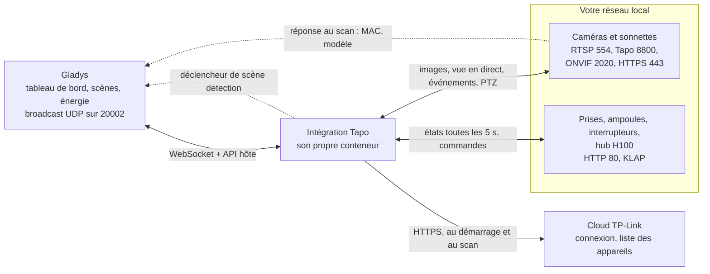
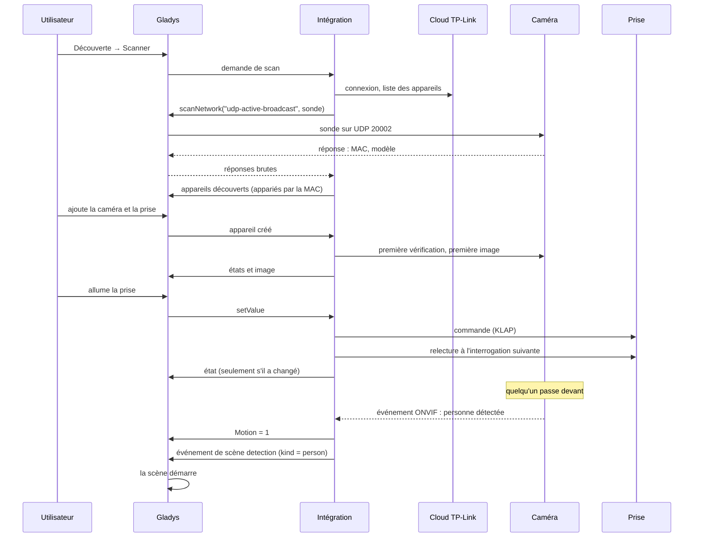
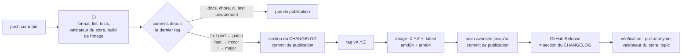

[English](README.md) · **Français** · [Deutsch](README.de.md) · [Español](README.es.md)

# gladys-tapo

[](LICENSE)
[](https://github.com/William-De71/gladys-tapo/releases)
[](https://github.com/William-De71/gladys-tapo/actions/workflows/release.yml)
[](https://gladysassistant.com)


Intégration externe [Gladys Assistant](https://gladysassistant.com) pour les appareils **TP-Link Tapo** : caméras et sonnettes, prises et multiprises, ampoules et rubans LED, interrupteurs muraux, et capteurs du hub H100. Installée depuis le store en un clic, elle ne demande qu'une chose au cloud TP-Link — la liste de vos appareils — et fait tout le reste **sur votre réseau local** : images, vue en direct, mouvement, appuis sur la sonnette, orientation, commandes et états. Les appareils sont localisés par un scan du réseau, leurs fonctionnalités suivent ce que chaque appareil répond, et une caméra qui voit une personne, un véhicule ou un animal peut lancer une scène.

📖 Documentation utilisateur : [English](docs/en.md) — [Français](docs/fr.md) — [Deutsch](docs/de.md) — [Español](docs/es.md)

> **Prérequis :** sur certains firmwares, la **Compatibilité tierce** doit être activée dans l'application Tapo (_Moi_ → _Services tiers_, ou _Moi_ → _Tapo Lab_ sur les anciennes versions de l'application). Sans elle, une caméra refuse RTSP et ONVIF, et certaines prises ou ampoules refusent le protocole local. C'est la première chose à vérifier quand un appareil « ne répond pas ».

## Fonctionnalités

- **Toutes les familles Tapo** : caméras et sonnettes, prises et multiprises, ampoules et rubans LED, interrupteurs muraux, capteurs du hub H100 (température, humidité, mouvement, ouverture, fuite, boutons, tête thermostatique).
- **Découverte automatique** : le cloud liste vos appareils, un scan du réseau trouve chacun par son adresse MAC ; une adresse ne se saisit que pour un appareil sur un autre sous-réseau.
- **Deux modes de capture** : RTSP avec le compte caméra (vue en direct comprise), ou le protocole propriétaire Tapo pour les modèles sur batterie et les sonnettes qui n'ont pas de RTSP.
- **Événements immédiats** : mouvement et appuis sur la sonnette poussés par ONVIF quand la caméra le propose, interrogés sinon ; un appui sur la sonnette envoie aussitôt une image fraîche.
- **Scènes** : le déclencheur **Détection d'une caméra Tapo** lance une scène sur une personne, un véhicule, un animal, un mouvement ou un appui sur la sonnette, caméra par caméra.
- **Orientation et positions** : des flèches sur le widget caméra et les positions enregistrées dans l'application Tapo, utilisables dans les scènes.
- **Mode privé** : la commande standard **Activée** des caméras Gladys, qui masque aussi l'objectif sur les modèles dotés d'un mode privé.
- **Ménage les batteries** : les caméras sur batterie et solaires ont leurs propres intervalles et cessent de capturer quand leur niveau baisse.
- **Quatre langues** : anglais, français, allemand et espagnol, dans Gladys et dans la documentation.

## Fonctionnement




Du scan à une commande, un état, une détection et une scène :



| Canal                                | Sert à                                                                              |
| ------------------------------------ | ----------------------------------------------------------------------------------- |
| **Cloud TP-Link** (HTTPS)            | la connexion à votre compte et la liste de vos appareils — rien d'autre             |
| **Scan du réseau** (UDP 20002)       | localiser chaque appareil, apparié par son adresse MAC ; broadcast émis par Gladys  |
| **Caméras** (RTSP, 8800, ONVIF, 443) | images, vue en direct, mouvement, sonnette, orientation, batterie, mode privé       |
| **Prises, lampes, hubs** (HTTP 80)   | états et commandes, lus toutes les quelques secondes, seuls les changements partent |

### Découverte : appariement par l'adresse MAC


La sonde est un paquet TDP bien formé (en-tête de 16 octets avec taille, drapeaux et CRC32, puis un corps JSON portant une clé publique RSA), relayé en broadcast par le cœur de Gladys (`network_discovery` dans le manifeste). Une réponse annonce un `device_id` **haché** de 32 caractères, et non l'identifiant de 40 caractères que liste le cloud : les réponses sont donc appariées par l'**adresse MAC**, le seul identifiant que les deux côtés donnent en clair. Le cœur autorise un scan toutes les 10 secondes : les résultats sont gardés en cache une minute, et un appareil conserve sa dernière adresse connue quand un scan échoue.

### Caméras : modes de capture


Le mode se décide en sondant la caméra, jamais d'après son nom de modèle : une caméra sans RTSP n'est pas une caméra sans accès local. Les modèles sur batterie et les sonnettes (C610, C425, D230…) ferment les ports 554 et 2020 mais servent leur vidéo par le protocole propriétaire sur le port 8800 — vérifié de bout en bout sur une C610.

La vidéo en direct n'existe que pour les caméras RTSP : elle passe par le paramètre `CAMERA_URL` confié au service rtsp-camera, et une session 8800 chiffrée ne peut pas s'écrire sous forme d'URL. Relayer le flux 8800 par un serveur HTTP dans l'intégration ne marche pas non plus : le réseau `gladys-integrations` est créé avec `com.docker.network.bridge.enable_icc=false`, donc rien ne peut se connecter VERS un conteneur d'intégration — pas même Gladys, qui est là où tourne ffmpeg. Une image plus lourde que ce qu'accepte l'hôte est réencodée localement à partir de la première capture plutôt que recapturée : une caméra sur batterie n'est réveillée qu'une fois par image.

### Caméras : événements


| Chemin                          | Fonctionnement                                                          | Latence               |
| ------------------------------- | ----------------------------------------------------------------------- | --------------------- |
| **ONVIF** (TCP 2020)            | `PullMessages` est tenu ouvert par la caméra, qui répond à la détection | quasi immédiat        |
| **Liste locale des détections** | `searchDetectionList` est interrogé toutes les `event_poll_interval`    | jusqu'à un intervalle |

ONVIF est ce qui rend un mouvement utilisable comme déclencheur de scène, et c'est le seul chemin qui signale le front **descendant**. Il demande le compte caméra : une caméra sans compte reste sur le chemin interrogé ; les caméras sur batterie y restent de toute façon, car un pull point tenu ouvert jour et nuit garderait leur radio éveillée. Les deux chemins ne tournent jamais ensemble sur la même caméra — sinon chaque mouvement lancerait sa scène deux fois. Les abonnements sont renouvelés avant d'expirer et libérés quand ils sont abandonnés : le firmware n'en garde que quelques-uns.

## Appareils pris en charge


Les capacités sont **demandées à chaque appareil**, jamais déduites de son modèle : une ampoule a un réglage de couleur parce que sa réponse contient une teinte, une prise un compteur d'énergie parce qu'elle a répondu à `get_energy_usage`, une caméra des flèches d'orientation parce que son profil ONVIF les déclare.

| Fonctionnalité caméra (nom dans Gladys) | Catégorie / type       | Créée quand                                                      |
| --------------------------------------- | ---------------------- | ---------------------------------------------------------------- |
| _le nom de la caméra_ (image)           | `camera/image`         | toujours                                                         |
| Enabled                                 | `camera/enabled`       | toujours (mode privé)                                            |
| Motion                                  | `motion-sensor/binary` | la caméra signale des événements                                 |
| Doorbell                                | `button/push`          | la caméra signale des événements, sauf si elle dit ne pas sonner |
| Capture                                 | `button/push`          | caméras sur batterie (image à la demande)                        |
| Move                                    | `camera/move`          | le profil ONVIF déclare l'orientation                            |
| Preset                                  | `camera/preset`        | la caméra a des positions enregistrées dans l'application Tapo   |
| Battery                                 | `battery/integer` (%)  | modèles sur batterie et solaires                                 |

| Appareil             | Exemples                           | Dans Gladys                                                  |
| -------------------- | ---------------------------------- | ------------------------------------------------------------ |
| Prise                | P100, P105, P115                   | Marche/arrêt                                                 |
| Prise avec mesure    | P110, P110M, P115                  | Marche/arrêt, puissance (W), énergie (kWh)                   |
| Multiprise           | P300, P304M, P306                  | Un appareil par prise, chacune pilotée seule                 |
| Ampoule, ruban LED   | L510, L530, L630, L900, L920, L930 | Marche/arrêt, luminosité, couleur et blanc (selon le modèle) |
| Interrupteur mural   | S500, S505 / S500D, S505D          | Marche/arrêt / variateur (luminosité)                        |
| Capteurs du hub H100 | T310, T315                         | Température, humidité                                        |
|                      | T100                               | Mouvement                                                    |
|                      | T110                               | Ouverture (porte, fenêtre)                                   |
|                      | T300                               | Fuite d'eau                                                  |
|                      | S200B, S200D                       | Bouton : simple clic, double clic                            |
|                      | KE100                              | Température et consigne de la tête thermostatique            |

Chaque capteur de hub devient un appareil à part, avec l'alerte de pile faible (et le niveau de pile quand le capteur le fournit). Les noms des fonctionnalités sont fixés par l'intégration en anglais (`Garage - Motion`), quelle que soit la langue de Gladys ; chacun peut être renommé. Pas encore pris en charge : le hub **H200** (il parle le protocole des caméras), les anciens appareils **Kasa** (protocole IOT), les aspirateurs robots et les interrupteurs de hub **S210 / S220** — ils sont signalés dans **Tester la connexion** et dans les journaux plutôt qu'ignorés en silence.

## Configuration

| Champ                                                           | Défaut       | Usage                                                                                        |
| --------------------------------------------------------------- | ------------ | -------------------------------------------------------------------------------------------- |
| E-mail / Mot de passe du compte Tapo                            | vide         | le compte de l'application Tapo ; la validation en deux étapes empêche cette connexion       |
| Région du cloud                                                 | Europe       | le cloud TP-Link le plus proche (Europe, Amérique, Asie, Mondial)                            |
| Identifiant / Mot de passe du compte par défaut                 | vide         | le compte caméra créé dans l'application Tapo, quand il est le même sur toutes les caméras   |
| Comptes par caméra (avancé)                                     | vide         | `nom\|identifiant\|motdepasse`, séparés par des virgules ; l'action plus bas est plus simple |
| Qualité de l'image                                              | HD           | HD est plus nette, SD plus légère et plus rapide à capturer                                  |
| Adresses manuelles (avancé)                                     | vide         | `nom\|ip` (ou `nom=ip`), séparés par des virgules ; l'action plus bas est plus sûre          |
| Intervalle de vérification des événements (s)                   | 20           | fréquence à laquelle une caméra sans ONVIF est interrogée sur ses détections (5 à 300)       |
| Intervalle de lecture des prises, lampes et capteurs (secondes) | 5            | fréquence de lecture des prises, ampoules, interrupteurs et hubs (2 à 300)                   |
| Délai de capture (s)                                            | 14           | temps accordé à une caméra pour fournir une image (5 à 60)                                   |
| Intervalle de rafraîchissement des images (s)                   | 60           | capture périodique des caméras sur secteur (15 à 3600)                                       |
| Rafraîchissement / vérification des caméras sur batterie (s)    | 900 / 300    | les deux mêmes intervalles pour les caméras sur batterie et solaires                         |
| Suspendre / bloquer / reprendre la capture (%)                  | 60 / 40 / 80 | les niveaux de batterie de la [protection de la batterie](#caméras-sur-batterie)             |

| Action                             | Ce qu'elle fait                                                                                              |
| ---------------------------------- | ------------------------------------------------------------------------------------------------------------ |
| Tester la connexion                | se connecte, scanne, et affiche une ligne par appareil : son adresse, sa provenance, son mode de capture     |
| Définir l'adresse IP d'un appareil | enregistre l'adresse d'un appareil (choisi dans la liste), vérifie qu'il répond et capture une image de test |
| Enregistrer le compte d'une caméra | enregistre le compte caméra d'une caméra, et tente aussitôt une capture avec                                 |
| Rafraîchir les images              | capture tout de suite une nouvelle image de chaque caméra                                                    |

Les adresses et comptes caméra enregistrés par les actions sont rattachés à l'**identifiant cloud** de l'appareil : renommer l'appareil, dans Gladys ou dans l'application Tapo, les conserve. Lancez **Définir l'adresse IP d'un appareil** avec une adresse vide pour revenir au scan.

## Transport

Le manifeste déclare `"transports": ["local", "cloud"]`, mais le cloud ne sert qu'à **lister** vos appareils : la connexion à votre compte et la liste des appareils, au démarrage et à chaque scan. Images, vue en direct, événements, commandes et états passent tous par votre réseau local — TP-Link n'offre de toute façon aux tiers aucun moyen d'obtenir une image par le cloud, et l'application Tapo joint ses caméras à distance par des relais réservés à son propre usage.

Les prises, ampoules, interrupteurs et hubs portent un **badge de transport** : **Local** tant que l'appareil répond à son interrogation, **Injoignable** sinon. Ils sont lus à chaque **Intervalle de lecture des prises, lampes et capteurs** — une requête par appareil physique, un hub à dix capteurs ne coûtant qu'une requête — et seules les valeurs qui ont changé sont envoyées à Gladys. Un appareil créé dans Gladys est lu aussitôt : son état et, pour une caméra, sa première image s'affichent sans attendre le tour suivant.

Trois protocoles locaux servent pour les prises, lampes et hubs, choisis d'après la réponse au scan ou trouvés en essayant : **TPAP** (firmwares 1.4 et suivants : connexion SPAKE2+ sur P-256 selon la RFC 9383, puis AES-128-CCM avec un numéro de séquence ; essayé quand un appareil refuse KLAP par un 403), **KLAP** (deux poignées de main, puis AES-128-CBC avec un numéro de séquence dans l'IV et une signature SHA-256 ; les deux générations de hachage) et l'ancien **securePassthrough** (poignée de main RSA, puis `login_device`). Les requêtes vers un appareil passent une à une ; plusieurs méthodes partent en un seul `multipleRequest` ; les prises d'une multiprise et les capteurs d'un hub sont joints par `control_child`. Les prises avec mesure ne donnent que l'énergie du jour, remise à zéro à minuit : elle est cumulée en un index kWh, la forme que lit le suivi d'énergie de Gladys.

## Scènes

| Déclencheur                 | Quand                                                                                          | Filtres         | Variables                |
| --------------------------- | ---------------------------------------------------------------------------------------------- | --------------- | ------------------------ |
| Détection d'une caméra Tapo | Une caméra ou une sonnette a vu une personne, un véhicule, un animal, un mouvement, ou a sonné | caméra, détecté | `camera`, `name`, `kind` |

| Détecté               | `kind`     | Signalé quand                                                                                     |
| --------------------- | ---------- | ------------------------------------------------------------------------------------------------- |
| Personne              | `person`   | la caméra a la détection intelligente, activée dans l'application Tapo, et a reconnu une personne |
| Véhicule              | `vehicle`  | de même, pour un véhicule                                                                         |
| Animal                | `pet`      | de même, pour un animal                                                                           |
| Mouvement             | `motion`   | tout autre mouvement — tous les mouvements, sur une caméra sans détection intelligente            |
| Appui sur la sonnette | `doorbell` | quelqu'un a sonné                                                                                 |

La caméra dit ce qu'elle a vu par ses topics ONVIF (`PeopleDetector`, `VehicleDetect`, `PetDetect`…) ou par les étiquettes de sa liste de détections ; l'intégration ne devine jamais. Chaque caméra et chaque type ne déclenchent **qu'une fois par minute au plus** : une caméra répète son état tant que dure le mouvement, et la scène tourne une fois par détection, pas par notification. Le simple mouvement qui accompagne une personne, un véhicule ou un animal ne déclenche rien de plus. Laissez **Caméra** vide pour surveiller toutes les caméras, **Détecté** vide pour tous les types. Seules les caméras ajoutées à Gladys déclenchent. Les fonctionnalités **Motion** et **Doorbell** restent utilisables avec le déclencheur standard **Changement d'état de l'appareil**.

Trois scènes pour commencer :

- **Éclairer le jardin quand quelqu'un y passe la nuit** : déclencheur **Détection d'une caméra Tapo** avec la caméra `Jardin`, détecté **Personne** ; condition **Condition temporelle** après 22:00 et avant 06:00 ; action **Allumer les lumières** sur les lampes du jardin, puis **Attendre** 5 minutes et **Eteindre les lumières**. Un chat qui traverse la pelouse n'allume rien.
- **Un coup de sonnette sur votre téléphone, avec la photo** : déclencheur **Détection d'une caméra Tapo** avec détecté **Appui sur la sonnette** ; action **Envoyer une image de caméra** avec la sonnette. L'intégration capture l'image dès l'appui sur le bouton : elle montre le visiteur. Ajoutez **Envoyer un message** « On a sonné à _Nom de la caméra_ » avec la variable **Nom de la caméra** si vous avez plusieurs sonnettes.
- **Ignorer les animaux** : une scène sur **Personne** et une autre sur **Véhicule**, plutôt qu'une seule sur tous les types. Sur une caméra sans détection intelligente, tout arrive en **Mouvement** : activez d'abord la détection intelligente dans l'application Tapo.

## Caméras sur batterie


C'est la capture qui vide une caméra sur batterie : les modèles sur batterie sont donc bridés. Par défaut, la capture périodique s'arrête sous 60 %, plus rien n'est capturé sous 40 %, et la capture reprend à 80 % — bien au-dessus du seuil de pause, car une recharge partielle relancerait la décharge et les cycles courts usent la batterie. Une caméra sur batterie qui ne répond plus est aussi limitée aux captures à la demande : son dernier niveau n'est plus fiable. Les caméras sur batterie ont leur propre intervalle de capture (15 minutes) et de vérification (5 minutes) : réveiller la caméra coûte bien plus que l'image elle-même. Elles n'ont ni vue en direct ni ONVIF : leurs détections, et le déclencheur de détection, arrivent à la vérification suivante. Les sonnettes ne sont jamais bridées — un appui doit arriver en quelques secondes. Tous les niveaux et intervalles sont réglables.

## Installation

1. Dans Gladys (**5.3.0 ou plus récent**) : **Intégrations**, cherchez **Tapo** dans le store, installez-la.
2. Dans son écran **Configuration**, saisissez votre compte Tapo (e-mail, mot de passe) et la région, puis cliquez sur **Tester la connexion**.
3. **Découverte → Scanner**, puis ajoutez vos appareils.
4. Pour les caméras filaires (RTSP), lancez **Enregistrer le compte d'une caméra** avec le compte caméra créé dans l'application Tapo (paramètres de la caméra → Paramètres avancés → Compte de la caméra) : il débloque RTSP, la vue en direct, le mouvement par ONVIF et l'orientation.

L'intégration exige Gladys 5.3.0 (déclencheur de scène depuis la 5.1.0, mots-clés du catalogue de Gladys 5.3) : un Gladys plus ancien ne reçoit plus ses mises à jour et reste sur la dernière version qu'il acceptait (2.0.0 en 5.0, 2.1.2 en 5.1 et 5.2) jusqu'à ce que Gladys lui-même soit mis à jour. En venant de la 1.x : l'**interrupteur de confidentialité** des caméras est remplacé par la commande **Activée** (`camera/enabled`) une fois la caméra mise à jour depuis l'écran Découverte — repointez les scènes qui l'utilisaient, ses valeurs sont inversées (1 veut maintenant dire « caméra active »). Le scan ne voit pas un appareil sur un autre sous-réseau ou VLAN : lancez **Définir l'adresse IP d'un appareil** avec l'adresse affichée dans l'application Tapo (paramètres de l'appareil → Infos sur l'appareil), et réservez cette adresse dans votre box. La [documentation utilisateur](docs/fr.md) détaille l'installation, les adresses, les caméras sur batterie, le mode privé, l'orientation et les scènes.

## Développement

```bash
npm install
GLADYS_HOST_API_URL="http://localhost:1443" \
GLADYS_INTEGRATION_TOKEN="<token>" \
npm start
```

`ffmpeg` doit être disponible pour capturer les images ; l'image Docker l'installe.

```
index.js                    branchement du SDK seulement : createApp(gladys), arrêt, connexion
src/
  app.js                    tous les handlers (découverte, commandes, images, actions, appareil créé)
  sceneEvents.js            déclencheur de scène detection (un événement par caméra et par type par minute)
  config.js                 valeurs par défaut, normalisation, saisies libres, stockages des actions
  devices.js                caméras -> appareils Gladys, résolution des adresses
  report.js                 rapport de connexion par appareil et messages d'état
  tapo/                     caméras et sonnettes
    constants.js            valeurs du protocole, délais, paramètres d'appareil
    cloud.js                client du cloud TP-Link (connexion, liste des appareils)
    discovery.js            scan TDP du réseau (UDP 20002), appariement MAC, cache du scan
    rtsp.js                 URL RTSP + détection du mode de capture (sondage des ports)
    snapshot.js             capture ffmpeg, deux modes, taille bornée
    localApi.js             API locale des caméras (HTTPS 443) : batterie, détections, mode privé
    onvif.js                événements ONVIF par pull point (port 2020), types de détection
    ptz.js                  PTZ ONVIF (pas d'orientation et de zoom, positions)
    events.js               surveillance sonnette / mouvement / batterie / mode privé
    batteryGuard.js         limitation des captures et interrogations des caméras sur batterie
    stream/
      aesHelper.js          dérivation de clé AES-128-CBC
      mediaSession.js       protocole de flux propriétaire (port 8800)
  smart/                    prises, multiprises, ampoules, interrupteurs, capteurs de hub
    http.js                 client HTTP minimal (port 80) avec échéance et cookies
    tpap.js                 transport TPAP (connexion SPAKE2+, sessions AES-CCM)
    klap.js                 transport KLAP (poignées de main, chiffrement de session)
    aes.js                  transport securePassthrough (poignée de main RSA, connexion)
    client.js               choix du transport, lots, enfants, temporisation
    model.js                réponses des appareils -> appareils, fonctionnalités et états Gladys
    manager.js              interrogation, publication des seuls changements, badges, commandes
```

L'identifiant de plateforme est l'**identifiant cloud** de l'appareil, la seule identité qui survit à un renommage ou à un nouveau bail DHCP ; l'adresse vit dans un paramètre de l'appareil. Les capteurs de hub et les prises de multiprise utilisent l'identifiant de l'enfant :

```
device : ext:<selector>:<camera|plug|light|switch|sensor>:<id>
feature: ext:<selector>:<camera|plug|light|switch|sensor>:<id>:<feature>
```

Les bugs trouvés côté Gladys pendant la construction de cette intégration (`select` dynamique refusé, champ `secret` d'un formulaire d'action, limite de 100 Ko sur les images de caméra) sont décrits dans [BUGS-GLADYS.md](BUGS-GLADYS.md).

## Tests

```bash
npm test               # node --test : fausses caméras et faux appareils TPAP/KLAP/AES sur localhost
npm run lint           # ESLint
npm run format:check   # Prettier, comme le lance la CI
npx github:GladysAssistant/integration-store . --skip-image-check
```

`test/structure.test.js` compare la découverte à `test/fixtures/discovery.baseline.json`, généré depuis la v2.0.0 avec quatre caméras (PTZ avec positions, sur batterie, sonnette, non sondée), une prise avec mesure, une multiprise, une ampoule couleur, un variateur, un interrupteur mural et un hub H100 avec ses six types de capteurs, et le manifeste à `test/fixtures/manifest.baseline.json` : un identifiant externe, une catégorie, un type, une unité, une borne ou une clé de configuration qui change obligerait les utilisateurs à recréer leurs appareils. `test/app.test.js` pilote les handlers avec le faux Gladys du SDK, `test/sceneEvents.test.js` le déclencheur de détection, et `test/i18n.test.js` vérifie les docs et ces README dans les quatre langues.

## Publication

Les publications sont automatiques. Chaque push sur `main` lance la CI, puis calcule la version suivante à partir des Conventional Commits depuis le dernier tag :



Le manifeste n'arrive sur `main` qu'une fois son image disponible, si bien que le store n'annonce jamais une version qu'il ne peut pas télécharger. `CHANGELOG.md` est généré : ne le modifiez jamais à la main. **Actions → Release → Run workflow** propose `release-as` (forcer une version) et `dry-run` (afficher la version et les notes sans publier).

Les titres de commit et de pull request suivent les [Conventional Commits](https://www.conventionalcommits.org/), en anglais, rédigés comme la ligne du changelog que l'utilisateur lira : `feat(scenes): start a scene when a camera sees a person, a vehicle, a pet, a motion or a doorbell press`. `feat` publie une version mineure, `fix` et `perf` un correctif, `!` ou un pied de commit `BREAKING CHANGE:` une version majeure ; `docs`, `chore`, `ci`, `test`, `style`, `refactor` et `build` seuls ne publient rien.

Si `main` est protégée (règle de protection de branche ou ruleset), le workflow ne peut l'avancer jusqu'au commit de publication que si **GitHub Actions** est autorisé à contourner la règle (Settings → Rules → Bypass list), ou avec le jeton d'une GitHub App ; sinon le tag et l'image sont publiés mais `main` reste en arrière.

## Résolution de problèmes

| Symptôme                                      | À vérifier                                                                                                                                                                                             |
| --------------------------------------------- | ------------------------------------------------------------------------------------------------------------------------------------------------------------------------------------------------------ |
| ✖ _introuvable sur votre réseau_              | autre sous-réseau ou VLAN, ou broadcast filtré : lancez **Définir l'adresse IP d'un appareil**                                                                                                         |
| ⚠ _ne répond pas_                             | appareil allumé, sur le même réseau que Gladys, **Compatibilité tierce** activée dans l'application Tapo (_Moi_ → _Services tiers_, ou _Moi_ → _Tapo Lab_ sur les anciennes versions de l'application) |
| Image de caméra mais pas de vue en direct     | la vue en direct demande RTSP : les modèles sur batterie et les sonnettes n'en ont pas ; pour une caméra filaire, enregistrez son compte caméra                                                        |
| Le mouvement arrive en retard                 | sans compte caméra, la caméra est interrogée : enregistrez-en un pour passer à ONVIF                                                                                                                   |
| La détection arrive toujours en **Mouvement** | la détection intelligente (personne, véhicule, animal) est désactivée dans l'application Tapo, ou le modèle ne l'a pas                                                                                 |
| Une caméra sur batterie ne se met plus à jour | la protection de la batterie l'a mise en pause — elle reprend au niveau de recharge (80 % par défaut)                                                                                                  |
| ✖ _refuse les applications tierces_           | prise, ampoule ou hub qui ne propose ni KLAP ni TPAP : dans l'application Tapo, désactivez la **Compatibilité tierce**, attendez une minute, réactivez-la                                              |
| Prise, ampoule ou hub refuse le compte Tapo   | vérifiez l'e-mail et le mot de passe tels que saisis dans l'application Tapo ; un firmware récent peut demander la **Compatibilité tierce**                                                            |
| Connexion refusée                             | la validation en deux étapes du compte TP-Link empêche la connexion d'une application tierce                                                                                                           |

Journaux : l'onglet **Supervision** de l'intégration ; ajoutez `DEBUG=gladys-integration-sdk` au conteneur pour le détail du SDK. La documentation utilisateur a une section de dépannage plus complète.

## Contribuer

Les issues et pull requests sont les bienvenues : [signaler un bug](https://github.com/William-De71/gladys-tapo/issues/new?template=bug_report.yml) (versions de Gladys et de l'intégration, modèle et firmware de l'appareil, journaux) ou [proposer une fonctionnalité](https://github.com/William-De71/gladys-tapo/issues/new?template=feature_request.yml). Retours et questions sont aussi les bienvenus sur le [fil du forum](https://community.gladysassistant.com/t/10531). Problèmes de sécurité : voir [SECURITY.md](SECURITY.md).

Le flux propriétaire des caméras est un portage Node.js de l'implémentation du flux média de [pytapo](https://github.com/JurajNyiri/pytapo), la même approche que go2rtc. Les protocoles KLAP et securePassthrough, ainsi que la sonde de découverte, sont implémentés d'après la description qu'en donne le projet [python-kasa](https://github.com/python-kasa/python-kasa) ; l'implémentation est indépendante. TPAP suit la description qu'en donne le projet [tapo](https://github.com/mihai-dinculescu/tapo) (MIT), implémentée elle aussi de façon indépendante. Construite sur le [SDK d'intégration Gladys](https://github.com/GladysAssistant/integration-sdk-js), à partir du [modèle officiel](https://github.com/GladysAssistant/integration-template-js).

## Licence

[Apache-2.0](LICENSE) — voir aussi [NOTICE](NOTICE). L'image Docker embarque [FFmpeg](https://ffmpeg.org) depuis les paquets Alpine Linux, sous ses propres licences (LGPL/GPL). TP-Link et Tapo sont des marques de TP-Link Systems Inc. ; ce projet n'est ni affilié à TP-Link, ni approuvé ou soutenu par TP-Link.
