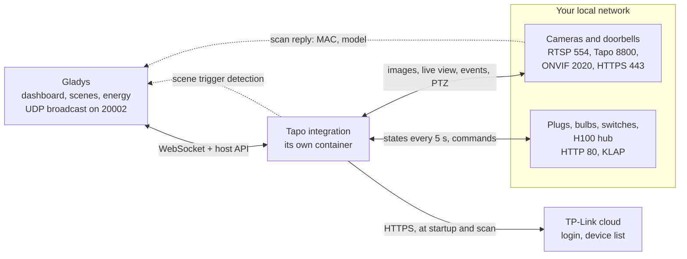
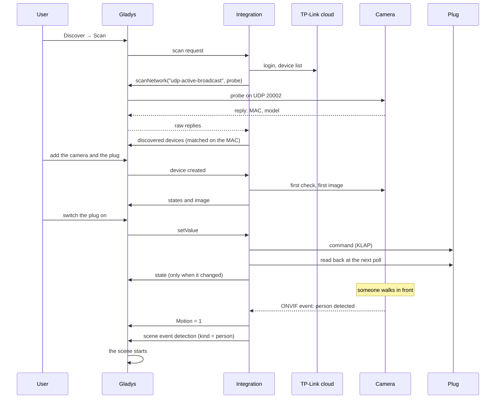
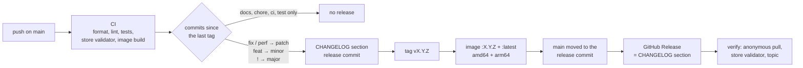

**English** · [Français](README.fr.md) · [Deutsch](README.de.md) · [Español](README.es.md)

# gladys-tapo

[](LICENSE)
[](https://github.com/William-De71/gladys-tapo/releases)
[](https://github.com/William-De71/gladys-tapo/actions/workflows/release.yml)
[](https://gladysassistant.com)


External [Gladys Assistant](https://gladysassistant.com) integration for **TP-Link Tapo** devices: cameras and doorbells, plugs and power strips, bulbs and light strips, wall switches, and the sensors of the H100 hub. Installed from the store in one click, it asks the TP-Link cloud for one thing only — the list of your devices — and does everything else **on your local network**: images, live view, motion, doorbell presses, pan/tilt, commands and states. Devices are located by a network scan, their features follow what each device answers, and a camera that sees a person, a vehicle or a pet can start a scene.

📖 User documentation: [English](docs/en.md) — [Français](docs/fr.md) — [Deutsch](docs/de.md) — [Español](docs/es.md)

> **Prerequisite:** on some firmwares, **Third-Party Compatibility** must be enabled in the Tapo app (_Me_ → _Third-Party Services_, or _Me_ → _Tapo Lab_ on older app versions). Without it, a camera refuses RTSP and ONVIF, and some plugs or bulbs refuse the local protocol. It is the first thing to check when a device "does not answer".

## Features

- **Every Tapo family**: cameras and doorbells, plugs and power strips, bulbs and light strips, wall switches, H100 hub sensors (temperature, humidity, motion, opening, leak, buttons, radiator valve).
- **Automatic discovery**: the cloud lists your devices, a network scan finds each one by its MAC address; an address is only typed for a device on another subnet.
- **Two capture modes**: RTSP with the camera account (live view included), or the proprietary Tapo protocol for the battery models and doorbells that have no RTSP.
- **Instant events**: motion and doorbell presses pushed over ONVIF when the camera offers it, polled otherwise; a doorbell press pushes a fresh image right away.
- **Scenes**: the **Tapo camera detection** trigger starts a scene on a person, a vehicle, a pet, a motion or a doorbell press, per camera.
- **Pan/tilt and presets**: arrows on the camera widget and the presets saved in the Tapo app, usable in scenes.
- **Private mode**: the standard **Enabled** control of Gladys cameras, which also covers the lens on the models that have a privacy mode.
- **Spares the batteries**: battery and solar cameras get their own intervals and stop capturing when their level drops.
- **Four languages**: English, French, German and Spanish, in Gladys and in the documentation.

## How it works




From the scan to a command, a state, a detection and a scene:



| Channel                              | Used for                                                                |
| ------------------------------------ | ----------------------------------------------------------------------- |
| **TP-Link cloud** (HTTPS)            | your account login and the list of your devices — nothing else          |
| **Network scan** (UDP 20002)         | locating each device, matched on its MAC address; broadcast by Gladys   |
| **Cameras** (RTSP, 8800, ONVIF, 443) | images, live view, motion, doorbell, pan/tilt, battery, private mode    |
| **Plugs, lights, hubs** (HTTP 80)    | state and commands, read every few seconds, only changes sent to Gladys |

### Discovery: matched on the MAC address


The probe is a well-formed TDP packet (16-byte header with payload size, flags and CRC32, then a JSON body carrying an RSA public key), relayed as a broadcast by the Gladys core (`network_discovery` in the manifest). A reply announces a **hashed** 32-character `device_id`, not the 40-character id the cloud lists, so replies are matched on the **MAC address**, the one identifier both sides state in clear. The core allows one scan every 10 seconds: results are cached for a minute, and a device keeps its last known address when a scan fails.

### Cameras: capture modes


The mode is decided by probing the camera, never by its model name: a camera without RTSP is not a camera without local access. Battery models and doorbells (C610, C425, D230…) close ports 554 and 2020 but serve their video over the proprietary protocol on port 8800 — verified end to end on a C610.

Live video is only available for RTSP cameras: it goes through the `CAMERA_URL` param handed to the rtsp-camera service, and an encrypted 8800 session cannot be expressed as a URL. Bridging the 8800 stream through an HTTP server inside the integration does not work either: the `gladys-integrations` network is created with `com.docker.network.bridge.enable_icc=false`, so nothing can connect INTO an integration container — not even Gladys, which is where ffmpeg runs. A frame larger than the host accepts is re-encoded locally from the first capture rather than captured again, so a battery camera is woken once per image.

### Cameras: events


| Path                     | How it works                                                          | Latency        |
| ------------------------ | --------------------------------------------------------------------- | -------------- |
| **ONVIF** (TCP 2020)     | `PullMessages` is held open by the camera, which answers on detection | ~instant       |
| **Local detection list** | `searchDetectionList` is polled every `event_poll_interval`           | up to one poll |

ONVIF is what makes a motion usable as a scene trigger, and it is the only path that reports the **falling** edge. It needs the camera account, so a camera without one stays on the polled path; battery cameras stay on it anyway, as a pull point held open around the clock would keep their radio awake. The two paths never run together on the same camera — otherwise every motion would fire its scene twice. Subscriptions are renewed before they lapse and released when dropped: the firmware only keeps a few.

## Supported devices


Capabilities are **asked of each device**, never guessed from its model: a bulb gets a color control because its answer carries a hue, a plug an energy meter because it answered `get_energy_usage`, a camera pan/tilt arrows because its ONVIF profile declares them.

| Camera feature (name in Gladys) | Category / type        | Created when                                             |
| ------------------------------- | ---------------------- | -------------------------------------------------------- |
| _the camera name_ (image)       | `camera/image`         | always                                                   |
| Enabled                         | `camera/enabled`       | always (private mode)                                    |
| Motion                          | `motion-sensor/binary` | the camera reports events                                |
| Doorbell                        | `button/push`          | the camera reports events, unless it says it has no bell |
| Capture                         | `button/push`          | battery cameras (on-demand image)                        |
| Move                            | `camera/move`          | the ONVIF profile declares pan/tilt                      |
| Preset                          | `camera/preset`        | the camera holds presets saved in the Tapo app           |
| Battery                         | `battery/integer` (%)  | battery and solar models                                 |

| Device            | Examples                           | In Gladys                                                    |
| ----------------- | ---------------------------------- | ------------------------------------------------------------ |
| Plug              | P100, P105, P115                   | On/off                                                       |
| Metering plug     | P110, P110M, P115                  | On/off, power (W), energy (kWh)                              |
| Power strip       | P300, P304M, P306                  | One device per socket, each switched on its own              |
| Bulb, light strip | L510, L530, L630, L900, L920, L930 | On/off, brightness, color and white (depending on the model) |
| Wall switch       | S500, S505 / S500D, S505D          | On/off / dimmer (brightness)                                 |
| H100 hub sensors  | T310, T315                         | Temperature, humidity                                        |
|                   | T100                               | Motion                                                       |
|                   | T110                               | Opening (door, window)                                       |
|                   | T300                               | Water leak                                                   |
|                   | S200B, S200D                       | Button: single click, double click                           |
|                   | KE100                              | Temperature and set point of the radiator valve              |

Each hub sensor becomes a device of its own, with a low-battery alert (and the battery level when the sensor reports it). Feature names are set by the integration in English (`Garage - Motion`), whatever the language of Gladys; each one can be renamed. Not supported yet: the **H200** hub (it speaks the cameras' protocol), the older **Kasa** devices (IOT protocol), robot vacuums and the **S210 / S220** hub switches — they are named in **Test the connection** and in the logs rather than silently ignored.

## Configuration

| Field                                              | Default      | Use                                                                             |
| -------------------------------------------------- | ------------ | ------------------------------------------------------------------------------- |
| Tapo account email / password                      | empty        | the account of the Tapo app; two-step verification prevents this login          |
| Cloud region                                       | Europe       | the TP-Link cloud closest to you (Europe, America, Asia, Worldwide)             |
| Default account username / password                | empty        | the camera account created in the Tapo app, when it is the same on every camera |
| Accounts per camera (advanced)                     | empty        | `name\|username\|password`, comma-separated; the action below is simpler        |
| Image quality                                      | HD           | HD is sharper, SD lighter and faster to capture                                 |
| Manual addresses (advanced)                        | empty        | `name\|ip` (or `name=ip`), comma-separated; the action below is safer           |
| Event check interval (s)                           | 20           | how often a camera without ONVIF is asked for its detections (5 to 300)         |
| Plugs, lights and sensors check interval (seconds) | 5            | how often plugs, bulbs, switches and hubs are read (2 to 300)                   |
| Capture timeout (s)                                | 14           | how long a camera is given to deliver an image (5 to 60)                        |
| Image refresh interval (s)                         | 60           | periodic capture of the wired cameras (15 to 3600)                              |
| Battery camera refresh / check interval (s)        | 900 / 300    | the same two intervals for battery and solar cameras                            |
| Pause / stop / resume capture (%)                  | 60 / 40 / 80 | the battery levels of the [battery protection](#battery-cameras)                |

| Action                  | What it does                                                                                               |
| ----------------------- | ---------------------------------------------------------------------------------------------------------- |
| Test the connection     | logs in, scans, and prints one line per device: its address, where it came from, how its image is captured |
| Set a device IP address | stores the address of one device (picked in the list), checks it answers and captures a test image         |
| Save a camera account   | stores the camera account of one camera, and tries a capture with it right away                            |
| Refresh the images      | captures a new image of every camera now                                                                   |

Addresses and camera accounts saved by the actions are stored against the device's **cloud id**: renaming the device, in Gladys or in the Tapo app, keeps them. Run **Set a device IP address** with an empty address to go back to the scan.

## Transport

The manifest declares `"transports": ["local", "cloud"]`, but the cloud is only used to **list** your devices: your account login and the device list, at startup and at each scan. Images, live view, events, commands and states all go over your local network — TP-Link offers third parties no way to get an image through the cloud anyway, and the Tapo app reaches its cameras remotely through relays reserved for its own use.

Plugs, bulbs, switches and hubs carry a **transport badge**: **Local** while the device answers its poll, **Unreachable** while it does not. They are read every **Plugs, lights and sensors check interval** — one request per physical device, a hub with ten sensors costing a single request — and only the values that changed are sent to Gladys. A device created in Gladys is read at once, so its state and, for a camera, its first image show up without waiting for the next round.

Three local protocols are spoken to plugs, lights and hubs, picked from the discovery reply or found by trying: **TPAP** (firmware 1.4 and later: SPAKE2+ login on P-256 per RFC 9383, then AES-128-CCM with a sequence number; tried when a device turns KLAP down with a 403), **KLAP** (two handshakes, then AES-128-CBC with a sequence number in the IV and a SHA-256 signature; both hashing generations) and the older **securePassthrough** (RSA handshake, then `login_device`). Requests to one device run one at a time; several methods go out as one `multipleRequest`; strip sockets and hub sensors are reached with `control_child`. Metering plugs only report today's energy, reset at midnight: it is accumulated into a cumulative kWh index, the shape the Gladys energy monitoring reads.

## Scenes

| Trigger               | When                                                                     | Filters          | Variables                |
| --------------------- | ------------------------------------------------------------------------ | ---------------- | ------------------------ |
| Tapo camera detection | A camera or a doorbell saw a person, a vehicle, a pet, a motion, or rang | camera, detected | `camera`, `name`, `kind` |

| Detected       | `kind`     | Reported when                                                                    |
| -------------- | ---------- | -------------------------------------------------------------------------------- |
| Person         | `person`   | the camera has smart detection, enabled in the Tapo app, and identified a person |
| Vehicle        | `vehicle`  | the same, for a vehicle                                                          |
| Pet            | `pet`      | the same, for a pet                                                              |
| Motion         | `motion`   | any other motion — every motion, on a camera without smart detection             |
| Doorbell press | `doorbell` | someone rang a doorbell                                                          |

The camera says what it saw through its ONVIF topics (`PeopleDetector`, `VehicleDetect`, `PetDetect`…) or the labels of its detection list; the integration never guesses. Each camera and kind fires **at most once a minute**: a camera repeats its state for as long as the motion lasts, and the scene runs once per detection, not per notification. The plain motion that comes with a person, a vehicle or a pet fires nothing more. Leave **Camera** empty to watch every camera, **Detected** empty for every kind. Only the cameras added to Gladys fire the trigger. The **Motion** and **Doorbell** features stay usable with the standard **Device state change** trigger.

Three scenes to start with:

- **Light the garden when someone is there at night**: trigger **Tapo camera detection** with camera `Garden`, detected **Person**; condition **Time condition** after 22:00 and before 06:00; action **Turn On the Lights** on the garden lights, then **Wait** 5 minutes and **Turn Off the Lights**. A cat crossing the lawn turns nothing on.
- **A doorbell press on your phone, with the picture**: trigger **Tapo camera detection** with detected **Doorbell press**; action **Send a camera image** with the doorbell. The integration captures the image as soon as the button is pressed, so it shows the visitor. Add **Send Message** "Someone rang at _Camera name_" with the variable **Camera name** for several doorbells.
- **Ignore the pets**: a scene on **Person** and another on **Vehicle**, rather than one on every kind. On a camera without smart detection, everything arrives as **Motion**: enable smart detection in the Tapo app first.

## Battery cameras


Capturing is what drains a battery camera, so battery models are throttled: by default the periodic capture stops below 60%, nothing is captured below 40%, and capturing resumes at 80% — well above the pause level, as a partial recharge would restart the drain and shallow cycles wear the cell. A battery camera that stops answering is also held to on-demand captures: its last level can no longer be trusted. Battery cameras have their own capture interval (15 minutes) and check interval (5 minutes): waking the camera costs far more than the image itself. They have no live view and no ONVIF: their detections, and the detection trigger, arrive at the next check. Doorbells are never throttled — a press must arrive within seconds. All the levels and intervals are configurable.

## Installation

1. In Gladys (**5.3.0 or newer**): **Integrations → Store**, search for **Tapo**, install.
2. On its **Configuration** screen, enter your Tapo account (email, password) and region, then click **Test the connection**.
3. **Discover → Scan**, then add your devices.
4. For the wired cameras (RTSP), run **Save a camera account** with the camera account created in the Tapo app (camera settings → Advanced settings → Camera account): it unlocks RTSP, the live view, motion over ONVIF and pan/tilt.

The integration requires Gladys 5.3.0 (scene trigger since 5.1.0, catalog keywords of Gladys 5.3): an older Gladys no longer receives its updates and stays on the last version it accepted (2.0.0 on 5.0, 2.1.2 on 5.1 and 5.2) until Gladys itself is updated. Coming from 1.x: the camera **privacy switch** is replaced by the **Enabled** control (`camera/enabled`) once the camera is updated from the Discover screen — re-point the scenes that used it, its values are reversed (1 now means "camera active"). The scan cannot see a device on another subnet or VLAN: run **Set a device IP address** with the address shown in the Tapo app (device settings → Device info), and reserve that address in your router. The [user documentation](docs/en.md) details the setup, the addresses, the battery cameras, the private mode, pan/tilt and the scenes.

## Development

```bash
npm install
GLADYS_HOST_API_URL="http://localhost:1443" \
GLADYS_INTEGRATION_TOKEN="<token>" \
npm start
```

`ffmpeg` must be available to capture images; the Docker image installs it.

```
index.js                    SDK wiring only: createApp(gladys), shutdown, connect
src/
  app.js                    every handler (discovery, commands, images, actions, device created)
  sceneEvents.js            scene trigger detection (one event per camera and kind per minute)
  config.js                 defaults, normalization, free-text parsing, action stores
  devices.js                cameras -> Gladys devices, address resolution
  report.js                 per-device connection report and status messages
  tapo/                     cameras and doorbells
    constants.js            protocol values, timings, device params
    cloud.js                TP-Link cloud client (login, device list)
    discovery.js            TDP network scan (UDP 20002), MAC matching, scan cache
    rtsp.js                 RTSP URL + capture mode detection (port probing)
    snapshot.js             ffmpeg capture, both modes, size-bounded
    localApi.js             camera local API (HTTPS 443): battery, detections, privacy
    onvif.js                ONVIF pull point events (port 2020), detection kinds
    ptz.js                  ONVIF PTZ (pan/tilt/zoom steps, presets)
    events.js               doorbell / motion / battery / privacy watcher
    batteryGuard.js         capture and poll throttling for battery cameras
    stream/
      aesHelper.js          AES-128-CBC key derivation
      mediaSession.js       proprietary stream protocol (port 8800)
  smart/                    plugs, power strips, bulbs, switches, hub sensors
    http.js                 minimal HTTP client (port 80) with deadline and cookies
    tpap.js                 TPAP transport (SPAKE2+ login, AES-CCM sessions)
    klap.js                 KLAP transport (handshakes, session crypto)
    aes.js                  securePassthrough transport (RSA handshake, login)
    client.js               transport choice, batches, children, backoff
    model.js                device answers -> Gladys devices, features and states
    manager.js              polling, change-only publishing, transport badges, commands
```

The platform id is the **cloud device id**, the one identity that survives a renaming or a new DHCP lease; the address lives in a device param. Hub sensors and strip sockets use the id of the child:

```
device : ext:<selector>:<camera|plug|light|switch|sensor>:<id>
feature: ext:<selector>:<camera|plug|light|switch|sensor>:<id>:<feature>
```

The bugs found on the Gladys side while building this integration (dynamic `select` rejected, `secret` field of an action form, 100 KB body limit on camera images) are described in [BUGS-GLADYS.md](BUGS-GLADYS.md).

## Tests

```bash
npm test               # node --test: fake cameras and fake TPAP/KLAP/AES devices on localhost
npm run lint           # ESLint
npm run format:check   # Prettier, as the CI runs it
npx github:GladysAssistant/integration-store . --skip-image-check
```

`test/structure.test.js` compares the discovery with `test/fixtures/discovery.baseline.json`, generated from v2.0.0 with four cameras (PTZ with presets, battery, doorbell, unprobed), a metering plug, a power strip, a colour bulb, a dimmer, a wall switch and an H100 hub with its six kinds of sensors, and the manifest with `test/fixtures/manifest.baseline.json`: an external id, a category, a type, a unit, a bound or a configuration key that changes would force users to recreate their devices. `test/app.test.js` drives the handlers with the fake Gladys of the SDK, `test/sceneEvents.test.js` the detection trigger, and `test/i18n.test.js` checks the docs and these READMEs in the four languages.

## Release

Releases are automatic. Every push on `main` runs the CI, then computes the next version from the Conventional Commits since the last tag:



The manifest only reaches `main` once its image exists, so the store never announces a version it cannot pull. `CHANGELOG.md` is generated: never edit it by hand. **Actions → Release → Run workflow** offers `release-as` (force a version) and `dry-run` (show the version and the notes without publishing).

Commit and pull request titles follow [Conventional Commits](https://www.conventionalcommits.org/), in English, written as the changelog line the user will read: `feat(scenes): start a scene when a camera sees a person, a vehicle, a pet, a motion or a doorbell press`. `feat` publishes a minor version, `fix` and `perf` a patch, `!` or a `BREAKING CHANGE:` footer a major; `docs`, `chore`, `ci`, `test`, `style`, `refactor` and `build` alone publish nothing.

If `main` is protected (branch protection rule or ruleset), the workflow can only move it to the release commit when **GitHub Actions** is allowed to bypass the rule (Settings → Rules → Bypass list), or with a GitHub App token; otherwise the tag and the image are published but `main` stays behind.

## Troubleshooting

| Symptom                                    | What to check                                                                                                                                                                       |
| ------------------------------------------ | ----------------------------------------------------------------------------------------------------------------------------------------------------------------------------------- |
| ✖ _not found on your network_              | another subnet or VLAN, or broadcast filtered: run **Set a device IP address**                                                                                                      |
| ⚠ _does not answer_                        | device powered on, on the same network as Gladys, **Third-Party Compatibility** enabled in the Tapo app (_Me_ → _Third-Party Services_, or _Me_ → _Tapo Lab_ on older app versions) |
| Camera image but no live view              | live view needs RTSP: battery models and doorbells have none; for a wired camera, save its camera account                                                                           |
| Motion fires late                          | without a camera account the camera is polled: save one to get ONVIF push                                                                                                           |
| Detection always arrives as **Motion**     | smart detection (person, vehicle, pet) is off in the Tapo app, or the model does not have it                                                                                        |
| Battery camera stops updating              | battery protection paused it — it resumes at the recharge level (80% by default)                                                                                                    |
| ✖ _refuses third-party apps_               | plug, bulb or hub offering neither KLAP nor TPAP: in the Tapo app, turn **Third-Party Compatibility** off, wait a minute, turn it on again                                          |
| Plug, bulb or hub refuses the Tapo account | check the email and password as typed in the Tapo app; a recent firmware may need **Third-Party Compatibility**                                                                     |
| Login refused                              | two-step verification on the TP-Link account prevents the login of a third-party application                                                                                        |

Logs: the **Supervision** tab of the integration; add `DEBUG=gladys-integration-sdk` to the container for the SDK details. The user documentation has a longer troubleshooting section.

## Contributing

Issues and pull requests are welcome: [bug report](https://github.com/William-De71/gladys-tapo/issues/new?template=bug_report.yml) (Gladys and integration versions, device model and firmware, logs) or [feature request](https://github.com/William-De71/gladys-tapo/issues/new?template=feature_request.yml). Feedback and questions also go to the [forum thread](https://community.gladysassistant.com/t/10531). Security problems: see [SECURITY.md](SECURITY.md).

The proprietary camera stream is a Node.js port of [pytapo](https://github.com/JurajNyiri/pytapo)'s media stream implementation, the same approach go2rtc uses. The KLAP and securePassthrough protocols, and the discovery probe, are implemented from the description the [python-kasa](https://github.com/python-kasa/python-kasa) project gives of them; the implementation is independent. TPAP follows the description the [tapo](https://github.com/mihai-dinculescu/tapo) project (MIT) gives of it, also implemented independently. Built on the [Gladys integration SDK](https://github.com/GladysAssistant/integration-sdk-js), from the [official template](https://github.com/GladysAssistant/integration-template-js).

## License

[Apache-2.0](LICENSE) — see also [NOTICE](NOTICE). The Docker image ships [FFmpeg](https://ffmpeg.org) from the Alpine Linux packages, under its own licenses (LGPL/GPL). TP-Link and Tapo are trademarks of TP-Link Systems Inc.; this project is not affiliated with, endorsed by or sponsored by TP-Link.
