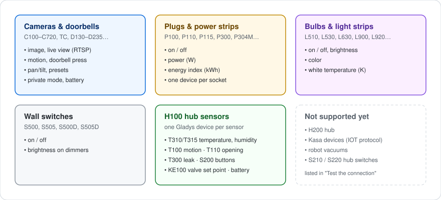
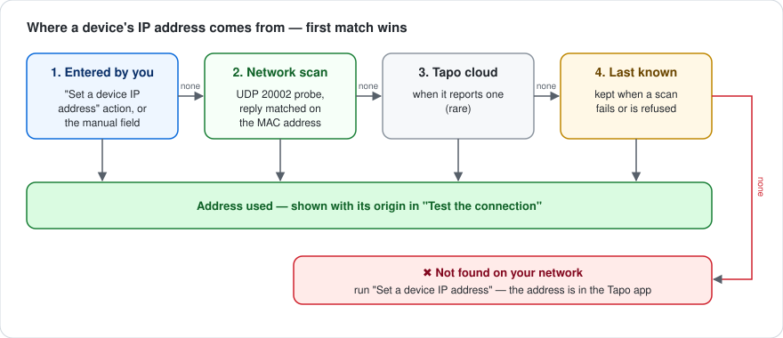
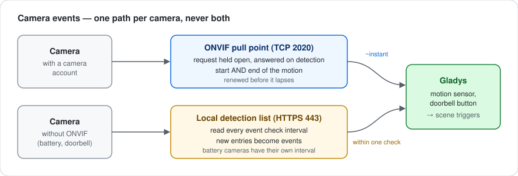

# gladys-tapo


[](https://github.com/William-De71/gladys-tapo/releases)
[](https://github.com/William-De71/gladys-tapo/actions/workflows/ci.yml)
[](https://gladysassistant.com)
[](LICENSE)

External integration bringing **TP-Link Tapo** devices to [Gladys Assistant](https://gladysassistant.com): cameras and doorbells, plugs and power strips, bulbs and light strips, wall switches, and the sensors of the H100 hub. Everything runs **on your local network** — the TP-Link cloud is only asked for the list of your devices.

📖 User documentation: [English](docs/en.md) · [Français](docs/fr.md) · [Deutsch](docs/de.md) · [Español](docs/es.md)

The integration speaks the four languages of Gladys: its Configuration screen, its actions and every message it shows are translated.

**Contents** — [Supported devices](#supported-devices) · [How it works](#how-it-works) · [Getting started](#getting-started) · [Troubleshooting](#troubleshooting) · [Upgrading from 1.x](#upgrading-from-1x) · [Architecture](#architecture) · [Development](#development) · [Technical notes](#technical-notes)

## Supported devices



Capabilities are **asked of each device**, never guessed from its model: a bulb gets a color control because its answer carries a hue, a plug an energy meter because it answered `get_energy_usage`, a camera pan/tilt arrows because its ONVIF profile declares them.

## How it works


| Channel                              | Used for                                                                |
| ------------------------------------ | ----------------------------------------------------------------------- |
| **TP-Link cloud** (HTTPS)            | your account login and the list of your devices — nothing else          |
| **Network scan** (UDP 20002)         | locating each device, matched on its MAC address; broadcast by Gladys   |
| **Cameras** (RTSP, 8800, ONVIF, 443) | images, live view, motion, doorbell, pan/tilt, battery, private mode    |
| **Plugs, lights, hubs** (HTTP 80)    | state and commands, read every few seconds, only changes sent to Gladys |

No image ever goes through the cloud — TP-Link offers third parties no way to get one there anyway.

## Getting started

Requires **Gladys 5.0** or later.

1. Install the integration from the Gladys integration catalog.
2. On its **Configuration** screen, enter your Tapo account (email, password) and region.
3. Click **Test the connection**: you get one line per device, with its address and where it came from.
4. Go to the **Discover** screen, run a scan, add your devices.
5. For cameras with RTSP (most wired ones), use **Save a camera account** with the camera account created in the Tapo app (camera settings > Advanced settings > Camera account) — it unlocks RTSP, the live view, motion over ONVIF and pan/tilt.

### When a device is not found



The scan cannot see devices on another subnet or VLAN, or behind a router that filters broadcast. For those, run **Set a device IP address**: pick the device in the list, type its address (shown in the Tapo app, device settings > Device info). Gladys checks the address answers and captures a test image. The address is stored against the device's cloud id, so renaming the device keeps it. Reserve that address in your router so it does not change.

## Troubleshooting

| Symptom                                    | What to check                                                                                                               |
| ------------------------------------------ | --------------------------------------------------------------------------------------------------------------------------- |
| ✖ _not found on your network_              | another subnet or VLAN, or broadcast filtered: run **Set a device IP address**                                              |
| ⚠ _does not answer_                        | device powered on, on the same network as Gladys, **Third-Party Compatibility** enabled in the Tapo app (_Me_ → _Tapo Lab_) |
| Camera image but no live view              | live view needs RTSP: battery models and doorbells have none; for a wired camera, save its camera account                   |
| Motion fires late                          | without a camera account the camera is polled: save one to get ONVIF push                                                   |
| Battery camera stops updating              | battery protection paused it — it resumes at the recharge level (80% by default)                                            |
| Plug, bulb or hub refuses the Tapo account | check the email and password as typed in the Tapo app; a recent firmware may need **Third-Party Compatibility**             |

The user documentation has a longer troubleshooting section, in [English](docs/en.md), [French](docs/fr.md), [German](docs/de.md) and [Spanish](docs/es.md).

## Upgrading from 1.x

- **Gladys 5.0 or later** is required.
- The camera **privacy switch** is replaced by Gladys' standard private mode, the **Enabled** control (`camera/enabled`), which also covers the lens on cameras that have a privacy mode. The old switch keeps working until the camera is updated from the Discover screen; after that, re-point the scenes that used it — its values are reversed (1 now means "camera active").
- Camera accounts and addresses typed in the text fields keep working; the actions are now the recommended way.

## Architecture

```
index.js                    SDK wiring: handlers, actions, lifecycle
src/
  config.js                 defaults, normalization, free-text parsing, action stores
  devices.js                cameras -> Gladys devices, address resolution
  report.js                 per-device connection report and status messages
  tapo/                     cameras and doorbells
    constants.js            protocol values and device params
    cloud.js                TP-Link cloud client (login, device list)
    discovery.js            TDP network scan (UDP 20002), MAC matching, scan cache
    rtsp.js                 RTSP URL + capture mode detection (port probing)
    snapshot.js             ffmpeg capture, both modes, size-bounded
    localApi.js             camera local API (HTTPS 443): battery, detections, privacy
    onvif.js                ONVIF pull point events (port 2020), motion pushed
    ptz.js                  ONVIF PTZ (pan/tilt/zoom steps, presets)
    events.js               doorbell / motion / battery / privacy watcher
    batteryGuard.js         capture and poll throttling for battery cameras
    stream/
      aesHelper.js          AES-128-CBC key derivation
      mediaSession.js       proprietary stream protocol (port 8800)
  smart/                    plugs, power strips, bulbs, switches, hub sensors
    http.js                 minimal HTTP client (port 80) with deadline and cookies
    klap.js                 KLAP transport (handshakes, session crypto)
    aes.js                  securePassthrough transport (RSA handshake, login)
    client.js               transport choice, batches, children, backoff
    model.js                device answers -> Gladys devices, features and states
    manager.js              discovery, polling, change-only publishing, commands
```

## Development

```bash
npm install
npm test          # node --test (fake cameras and fake KLAP/AES devices over real HTTP)
npm run lint      # eslint
npm run format    # prettier
```

`ffmpeg` must be available to capture images; the Docker image installs it.

## Technical notes

### Network discovery

The probe is a well-formed TDP packet (16-byte header with payload size, flags and CRC32, then a JSON body carrying an RSA public key), relayed as a broadcast by the Gladys core (`network_discovery` in the manifest). A reply announces a **hashed** 32-character `device_id`, not the 40-character id the cloud lists, so replies are matched on the **MAC address**, the one identifier both sides state in clear. The core allows one scan every 10 seconds: results are cached for a minute, and a device keeps its last known address when a scan fails.

### Cameras: capture modes


The mode is decided by probing the camera, never by its model name: a camera without RTSP is not a camera without local access. Battery models and doorbells (C610, C425, D230…) close ports 554 and 2020 but serve their video over the proprietary protocol on port 8800 — verified end to end on a C610.

Live video is only available for RTSP cameras: it goes through the `CAMERA_URL` param handed to the rtsp-camera service, and an encrypted 8800 session cannot be expressed as a URL. Bridging the 8800 stream through an HTTP server inside the integration does not work either: the `gladys-integrations` network is created with `com.docker.network.bridge.enable_icc=false`, so nothing can connect INTO an integration container — not even Gladys, which is where ffmpeg runs.

A frame larger than the host accepts is re-encoded locally from the first capture rather than captured again, so a battery camera is woken once per image.

### Cameras: battery protection


Capturing is what drains a battery camera, so battery models are throttled: by default the periodic capture stops below 60%, nothing is captured below 40%, and capturing resumes at 80%. Battery cameras also get their own capture and poll intervals. All of it is configurable.

### Cameras: events



| Path                     | How it works                                                          | Latency        |
| ------------------------ | --------------------------------------------------------------------- | -------------- |
| **ONVIF** (TCP 2020)     | `PullMessages` is held open by the camera, which answers on detection | ~instant       |
| **Local detection list** | `searchDetectionList` is polled every `event_poll_interval`           | up to one poll |

ONVIF is what makes a motion usable as a scene trigger, and it is the only path that reports the **falling** edge. It needs the camera account, so a camera without one stays on the polled path. The two paths never run together on the same camera — otherwise every motion would fire its scene twice. Subscriptions are renewed before they lapse and released when dropped: the firmware only keeps a few.

### Plugs, lights and hubs: protocol

Two local protocols, picked from the discovery reply or found by trying: **KLAP** (two handshakes, then AES-128-CBC with a sequence number in the IV and a SHA-256 signature; both hashing generations, detected from the handshake answer itself) and the older **securePassthrough** (RSA handshake, then `login_device`, login v1 or v2). Requests to one device run one at a time; several methods go out as one `multipleRequest`; strip sockets and hub sensors are reached with `control_child`. A hub with ten sensors costs a single request per round.

Metering plugs only report today's energy, reset at midnight. It is accumulated into a cumulative kWh index — the shape the Gladys energy monitoring reads consumption from.

## Credits

- The proprietary camera stream is a Node.js port of [pytapo](https://github.com/JurajNyiri/pytapo)'s media stream implementation, the same approach go2rtc uses.
- The KLAP and securePassthrough protocols, and the discovery probe, are implemented from the description the [python-kasa](https://github.com/python-kasa/python-kasa) project gives of them; the implementation is independent.

## License

[Apache-2.0](LICENSE)
